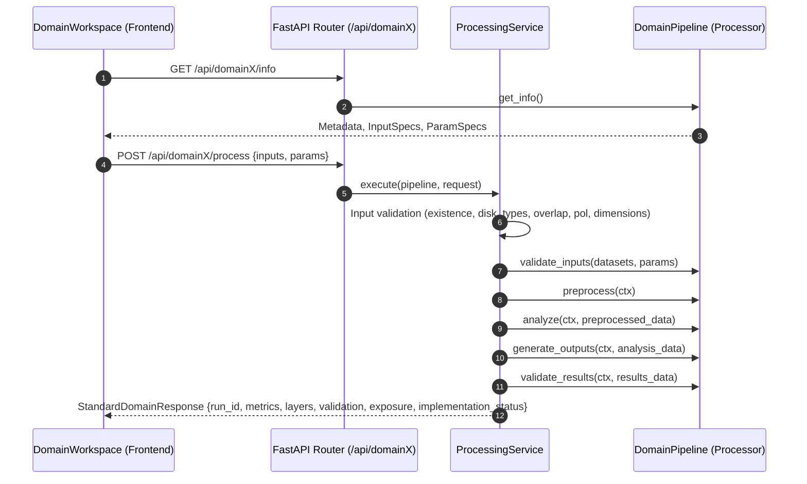

# NISAR Common Domain Contract Specification

**Project:** NASA Space Apps — Dancing with the SARs (NISAR)
**Document:** `docs/architecture/domain-contract.md`
**Interface Class:** `app.services.pipeline.DomainInterface` / `app.services.pipeline.DomainPipeline`
**Status:** Approved Standard

---

## 1. Lifecycle Architecture

Every scientific processor in NISAR conforms to the 6-stage lifecycle defined in `DomainInterface`:

---

## 2. Standard Lifecycle Methods

### Stage 1: `get_info() -> dict[str, Any]`
Returns domain metadata and operational specifications used by the UI to dynamically build selectors and controls:
- `domain`: e.g. `"domain1"`
- `analysis`: e.g. `"Floods & Wetlands Inundation Analysis"`
- `summary`: Scientific summary paragraph.
- `implementation_status`: `"implemented" | "partial" | "demonstration" | "planned"`.
- `inputs`: List of `InputSpec` dictionaries (`role`, `label`, `product_types`, `required`, `description`).
- `parameters`: List of `ParamSpec` dictionaries (`name`, `label`, `type`, `default`, `min`, `max`, `options`).
- `deferred_features`: List of future planned scientific algorithms.

### Stage 2: `validate_inputs(datasets: dict, params: dict) -> None`
Verifies that:
- All required input roles are supplied.
- All supplied parameter values are within allowed numeric ranges (`min`, `max`) or option choices.
- Raises `PipelineInputError` (HTTP 422) if an input role is missing or invalid.

### Stage 3: `preprocess(ctx: PipelineContext) -> Any`
- Reads georeferenced raster bands using `app.utils.raster.read_band()`.
- Converts linear power to $\text{dB}$ via `power_to_db()`.
- Applies multi-looking or spatial filtering via `box_mean()`.
- Resamples and reprojects auxiliary datasets (DEM, masks) to match primary SAR geometry using `align_to()`.
- In `DomainPipeline`, raises `NotImplementedError` if not overridden by the domain processor, preventing incomplete domains from proceeding silently.

### Stage 4: `analyze(ctx: PipelineContext, preprocessed: Any) -> Any`
Executes physical domain equations:
- **D1 Floods:** Bounded Otsu thresholding + relative backscatter drop ($\Delta\text{dB} < \text{threshold}$).
- **D2 Forests:** Cross-polarized volume backscatter differencing + canopy drift normalization.
- **D3 Earthquakes:** Coherence-masked unwrapped InSAR LOS phase-to-displacement conversion.
- **D4 Agriculture:** Multi-temporal backscatter trajectory and radar crop/soil condition index.
- **D5 Glaciers:** Fast-flowing outlet ice stream extraction and terminus calving edge detection.
- In `DomainPipeline`, raises `NotImplementedError` if not overridden.

### Stage 5: `generate_outputs(ctx: PipelineContext, analysis: Any) -> dict[str, Any]`
- Writes georeferenced GeoTIFF deliverables to `ctx.out("output.tif")` via `write_geotiff()`.
- Generates 8-bit RGBA preview overlays for Cesium and Leaflet via `write_class_png()` or `write_ramp_png()`.
- Registers generated files using `ctx.add_layer(key, label, kind, filename, bounds_wgs84)`.
- Calculates georeferenced surface area in hectares and $\text{km}^2$ using `mask_area_m2()`.
- Returns summary KPI metrics (`label`, `value`, `unit`).
- In `DomainPipeline`, raises `NotImplementedError` if not overridden. Output must contain at least one layer or metric; empty outputs raise `PipelineExecutionError`.

### Stage 6: `validate_results(ctx: PipelineContext, results: Any) -> Any`
- If an independent reference dataset is supplied, executes rigorous validation:
  - Binary classification: Confusion matrix ($\text{TP}, \text{FP}, \text{FN}, \text{TN}$), $\text{IoU}$, $\text{F}_1$, $\text{Precision}$, $\text{Recall}$.
  - Continuous measurements: $\text{RMSE}$, $\text{MAE}$, $\text{Bias}$, and Pearson correlation coefficient $r$.
- If an exposure GeoJSON layer is supplied, executes spatial intersection via `evaluate_spatial_exposure()`.

---

## 3. Enforcement of Implementation Status

The platform strictly categorizes and enforces domain status:
- **`implemented`**: Complete scientific pipeline running on real or validated SAR data (e.g., D1, D2, D3, D5).
- **`partial`**: Core stages functioning but auxiliary features deferred.
- **`demonstration`**: Functioning prototype using calibrated or synthetic proxy data awaiting orbital data (e.g., D4 Quad-Pol L-band).
- **`planned`**: Spec declared; execution is rejected by `ProcessingService` with HTTP 422 until implemented.
