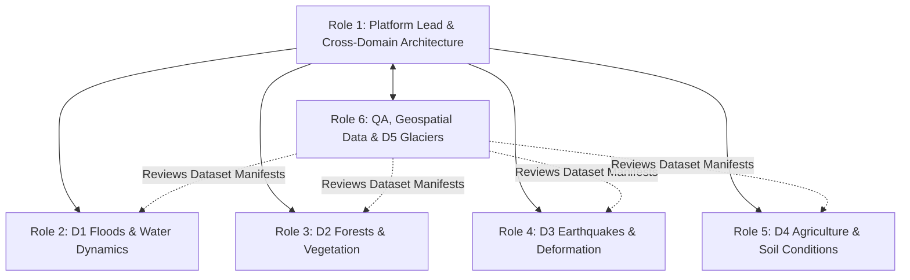

# NISAR Team Ownership & Codebase Responsibility Matrix

**Project:** NASA Space Apps — Dancing with the SARs (NISAR)
**Document:** `docs/architecture/team-ownership.md`
**Audience:** Six-Member Engineering & Science Team
**Status:** Canonical Foundation

---

## 1. Overview & Six-Member Team Structure

To enable parallel development without merge conflicts or regressions, repository responsibilities are strictly partitioned across six dedicated roles:

---

## 2. Detailed Role Responsibility & File Ownership

### Member 1: Platform Integration Lead
- **Domain Focus:** Platform Architecture, Shared Contracts, Earth Event Explorer, Core Routing.
- **Core Platform Ownership:**
  - `backend/app/main.py`, `backend/app/config.py`, `backend/app/api/routes.py`
  - `backend/app/services/pipeline.py`, `backend/app/services/processing_service.py`
  - `backend/app/schemas/` (`results.py`, `dataset.py`, `common.py`)
  - `frontend/src/App.jsx`, `frontend/src/routes/AppRoutes.jsx`, `frontend/src/config/domains.js`
  - `frontend/src/layouts/` (`MainLayout.jsx`, `DomainLayout.jsx`)
  - `frontend/src/pages/EarthEventExplorer.jsx`, `frontend/src/components/navigation/`
  - `frontend/src/components/map/` (`SharedMap.jsx`, `CesiumGlobe.jsx`)
- **Governance Gatekeeper:** Reviews all PRs touching shared platform services, schemas, or routing.

### Member 2: Floods & Water Dynamics Specialist (D1)
- **Domain Focus:** Floods, Standing Water & Wetland Extent (`domain1` — Thessaly Storm Daniel Lake Karla basin).
- **Domain Ownership:**
  - `backend/app/domains/domain1/` (`processor.py`, `preprocessing.py`, `analysis.py`, `visualization.py`)
  - `backend/app/api/endpoints/domain1.py`
  - `frontend/src/domains/domain1/` (`Domain1Page.jsx`, components, hooks)
  - `data/raw/domain1/` (read-only reference)
  - `docs/domains/floods-water-dynamics/`

### Member 3: Forests & Vegetation Specialist (D2)
- **Domain Focus:** Forests, Deforestation & Wildfire Disturbance (`domain2` — Pará BR-163 deforestation, Dadia/Evros wildfire).
- **Domain Ownership:**
  - `backend/app/domains/domain2/` (`processor.py`, `preprocessing.py`, `analysis.py`, `visualization.py`)
  - `backend/app/api/endpoints/domain2.py`
  - `frontend/src/domains/domain2/` (`Domain2Page.jsx`, components, hooks)
  - `data/raw/domain2/` (read-only reference)
  - `docs/domains/forests-vegetation/`

### Member 4: Earthquakes & Ground Deformation Specialist (D3)
- **Domain Focus:** Ground Deformation & InSAR Phase Analysis (`domain3` — Tyrnavos Mw 6.3 earthquake coseismic field).
- **Domain Ownership:**
  - `backend/app/domains/domain3/` (`processor.py`, `preprocessing.py`, `analysis.py`, `visualization.py`)
  - `backend/app/api/endpoints/domain3.py`
  - `frontend/src/domains/domain3/` (`Domain3Page.jsx`, components, hooks)
  - `docs/domains/earthquakes-ground-deformation/`

### Member 5: Agriculture & Soil Conditions Specialist (D4)
- **Domain Focus:** Agricultural Radar Indicators & Soil Moisture (`domain4` — Sacramento/San Joaquin Valley).
- **Domain Ownership:**
  - `backend/app/domains/domain4/` (`processor.py`, `preprocessing.py`, `analysis.py`, `visualization.py`)
  - `backend/app/api/endpoints/domain4.py`
  - `frontend/src/domains/domain4/` (`Domain4Page.jsx`, components, hooks)
  - `docs/domains/agriculture-soil-conditions/`

### Member 6: QA, Geospatial Data & Cryosphere Specialist (D5)
- **Domain Focus:** Glaciers, Snow & Ice (`domain5` — Jakobshavn Isbræ ice velocity, terminus calving) and Platform Quality Assurance.
- **Domain Ownership:**
  - `backend/app/domains/domain5/` (`processor.py`, `preprocessing.py`, `analysis.py`, `visualization.py`)
  - `backend/app/api/endpoints/domain5.py`
  - `frontend/src/domains/domain5/` (`Domain5Page.jsx`, components, hooks)
  - `data/manifests/datasets.json` (central manifest coordination)
  - `scripts/validate_datasets.py`
  - `docs/domains/glaciers-snow-ice/`
