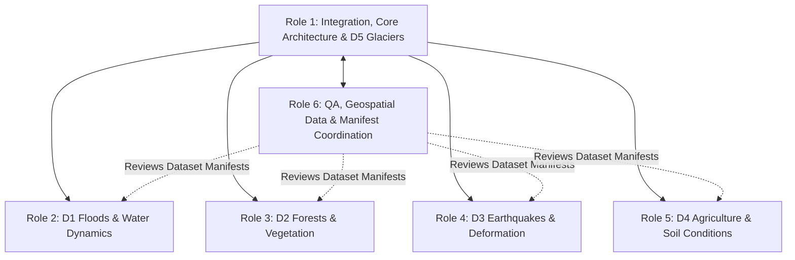

# NISAR Team Ownership & Codebase Responsibility Matrix

**Project:** NASA Space Apps — Dancing with the SARs (NISAR)
**Document:** `docs/development/team-ownership.md`
**Audience:** Six-Member Engineering & Science Team
**Status:** Canonical Foundation

---

## 1. Overview & Six-Member Team Structure

To enable parallel development without merge conflicts or regressions, repository responsibilities are strictly partitioned across six dedicated roles:



---

## 2. Detailed Role Responsibility & File Ownership

### Member 1: Platform Integration Lead & D5 Specialist
- **Domain Focus:** Glaciers, Snow & Ice (`domain5` — Jakobshavn Isbræ ice velocity, fast-flowing ice trunk extraction, terminus edge calving delineation).
- **Core Platform Ownership:**
  - `backend/app/main.py`, `backend/app/config.py`, `backend/app/api/routes.py`
  - `backend/app/services/pipeline.py`, `backend/app/services/processing_service.py`
  - `backend/app/schemas/` (`results.py`, `dataset.py`, `common.py`)
  - `frontend/src/App.jsx`, `frontend/src/routes/AppRoutes.jsx`, `frontend/src/config/domains.js`
  - `frontend/src/layouts/` (`MainLayout.jsx`, `DomainLayout.jsx`)
- **Domain Ownership:**
  - `backend/app/domains/domain5/`
  - `backend/app/api/endpoints/domain5.py`
  - `frontend/src/domains/domain5/`
  - `docs/domains/glaciers-snow-ice/`
- **Governance Gatekeeper:** Reviews all PRs touching shared platform services, schemas, or routing.

### Member 2: Floods & Water Dynamics Specialist (D1)
- **Domain Focus:** Floods, Standing Water & Wetland Extent (`domain1` — Thessaly Storm Daniel Lake Karla basin).
- **Domain Ownership:**
  - `backend/app/domains/domain1/` (`processor.py`, `preprocessing.py`, `analysis.py`, `visualization.py`)
  - `backend/app/api/endpoints/domain1.py`
  - `frontend/src/domains/domain1/` (`Domain1Page.jsx`, components, hooks)
  - `data/raw/domain1/` (read-only reference)
  - `docs/domains/floods-water-dynamics/`
  - `backend/tests/test_domain1_pipeline.py`

### Member 3: Forests & Wildfires Specialist (D2)
- **Domain Focus:** Forest Disturbance & Wildfire Recovery (`domain2` — Pará BR-163 deforestation, Dadia/Evros & Park Fire burn severity).
- **Domain Ownership:**
  - `backend/app/domains/domain2/` (`processor.py`, `preprocessing.py`, `analysis.py`, `visualization.py`)
  - `backend/app/api/endpoints/domain2.py`
  - `frontend/src/domains/domain2/` (`Domain2Page.jsx`, components, hooks)
  - `data/raw/domain2/` (read-only reference)
  - `docs/domains/forests-vegetation/`

### Member 4: Earthquakes & Ground Deformation Specialist (D3)
- **Domain Focus:** Surface Displacement & InSAR Coherence (`domain3` — Tyrnavos Mw 6.3 coseismic LOS deformation, GNSS benchmark validation).
- **Domain Ownership:**
  - `backend/app/domains/domain3/` (`processor.py`, `preprocessing.py`, `analysis.py`, `visualization.py`)
  - `backend/app/api/endpoints/domain3.py`
  - `frontend/src/domains/domain3/` (`Domain3Page.jsx`, components, hooks)
  - `data/raw/domain3/` (read-only reference)
  - `docs/domains/earthquakes-ground-deformation/`

### Member 5: Agriculture & Soil Conditions Specialist (D4)
- **Domain Focus:** Agricultural Phenology & Soil Roughness/Moisture Proxies (`domain4` — Central Valley agricultural study area / Thessaly agricultural plain).
- **Domain Ownership:**
  - `backend/app/domains/domain4/` (`processor.py`, `preprocessing.py`, `analysis.py`, `visualization.py`)
  - `backend/app/api/endpoints/domain4.py`
  - `frontend/src/domains/domain4/` (`Domain4Page.jsx`, components, hooks)
  - `data/raw/domain4/` (read-only reference)
  - `docs/domains/agriculture-soil-conditions/`

### Member 6: Shared QA, Geospatial Data & Manifest Coordinator
- **Core Platform Ownership:**
  - `data/manifests/datasets.json`, `data/manifests/processing_runs.json`
  - `scripts/validate_datasets.py`, `scripts/acquire_real_sar_data.py`, `scripts/generate_dataset_manifest.py`
  - `backend/tests/test_audit_workflows.py`, `backend/tests/test_datasets.py`, `backend/tests/test_platform_features.py`
  - `frontend/src/pages/EarthEventExplorer.jsx`
  - `docs/dataset-inventory.md`, `docs/validation-report.md`
- **Data Governance:** Enforces raw dataset immutability, coordinates STAC metadata alignment, and validates coordinate reference systems (`EPSG:XXXXX`) and bounding boxes across all domains.

---

## 3. Shared Files Requiring Integration Review

The following files impact multiple domains and **require explicit approval from Member 1 (Integration Lead)** before merging into `main`:

```
backend/app/services/pipeline.py
backend/app/services/processing_service.py
backend/app/schemas/results.py
backend/app/schemas/dataset.py
backend/app/database/models.py
backend/app/api/routes.py
frontend/src/components/DomainWorkspace.jsx
frontend/src/components/BeforeAfterViewer.jsx
frontend/src/components/map/SharedMap.jsx
frontend/src/components/map/CesiumGlobe.jsx
frontend/src/routes/AppRoutes.jsx
data/manifests/datasets.json
```
