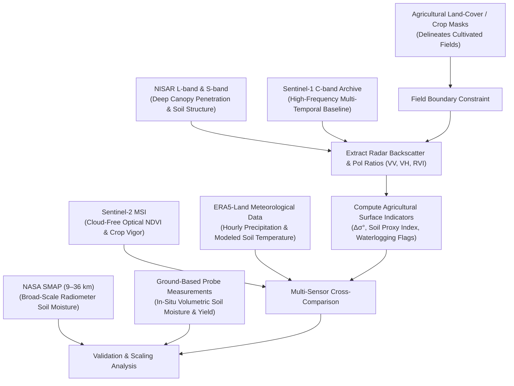
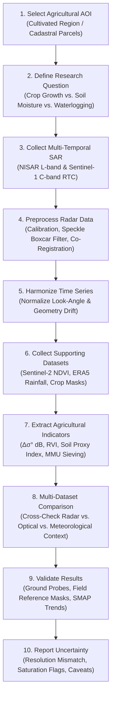

# Domain 4: Agriculture & Soil Conditions — Specification & Documentation
**Dataset Selection, Radar Indicator Retrieval & Validation Strategy for Dancing with the SARs**

Welcome to the comprehensive scientific, architectural, and operational specification for **Domain 4: Agriculture & Soil Conditions** of the **NISAR — Dancing with the SARs** platform.

---

## 1. Executive Summary & Objective

- **Domain Identifier:** `domain4`
- **Domain Name:** **Agriculture & Soil Conditions**
- **Assigned Role:** **Team Member 4 — Radar-Derived Agricultural Indicators and Soil Dynamics Analysis**
- **Objective:** Use Synthetic Aperture Radar (SAR) observations to investigate agricultural conditions, crop development cycles, soil-moisture dynamics, and land-management changes across cultivated landscapes.
- **Why SAR is Essential:** Optical satellites are severely impaired by persistent cloud cover, haze, and smoke during active growing seasons. Active microwave radar penetrates clouds and can observe day and night, providing regular repeat observations.
- **Core Physical Reality & Limitation:** Radar backscatter ($\sigma^0$) is **not a direct, unambiguous measurement of soil moisture or crop health**. The backscatter signal represents a complex, coupled interaction between:
  1. **Soil Dielectric Permittivity:** Strongly driven by volumetric soil moisture content.
  2. **Surface Roughness:** Centimeter-scale soil tilling, plowing ridges, and furrow orientation relative to the radar look direction.
  3. **Vegetation Canopy Structure:** Plant height, stem density, leaf moisture, and volume scattering versus double-bounce.
  4. **Radar Acquisition Geometry:** Sensor incidence angle ($\theta$), polarization (VV, VH, HH, HV), and wavelength ($\lambda$).
- **Primary Deliverables:** Field-scale backscatter dynamic maps, agricultural surface change perimeters, soil moisture and surface roughness proxies, crop development indicators, and rigorous validation against independent ground and satellite benchmarks.

---

## 2. Dataset Combination Strategy

To disentangle soil moisture from vegetation growth and surface roughness, this domain employs a multi-sensor combination where **each dataset serves a distinct, non-interchangeable purpose**:

$$\text{NISAR} + \text{Sentinel-1} + \text{Sentinel-2} + \text{NASA SMAP} + \text{ERA5-Land} + \text{Agricultural Land-Cover Data} + \text{Ground-Based Measurements}$$



### Dataset Roles & Physical Functions

| Dataset | Primary Role in Domain 4 | Why It Is Distinct & Essential |
| :--- | :--- | :--- |
| **NISAR L-SAR & S-SAR** | Primary radar observations for agricultural fields, crop structure, and soil conditions. | L-band ($\lambda \approx 24\text{ cm}$) penetrates into leafy crop canopies to interact directly with the underlying soil surface, offering superior sensitivity to soil moisture and deep root-zone structure where C-band saturates. |
| **Sentinel-1 C-SAR** | Historical time series, seasonal baseline tracking, and algorithm development. | Regular 6-to-12 day revisit cycles (2014–present) provide the temporal density needed to construct multi-month crop phenology profiles. |
| **Sentinel-2 MSI** | Optical crop monitoring and vegetation index retrieval (NDVI, NDRE, EVI). | Provides cloud-free optical evidence of chlorophyll vigor and leaf area index (LAI) to cross-validate whether radar changes represent crop growth or bare-soil changes. |
| **NASA SMAP** | Broad-scale soil-moisture trend comparison and contextual calibration. | L-band radiometer ($9\text{--}36\text{ km}$) dedicated to soil moisture; confirms whether regional SAR backscatter surges align with broad-scale soil drying or wetting trends. |
| **ERA5-Land** | Meteorological and land-surface environmental context. | Gridded hourly precipitation, evapotranspiration, and topsoil temperature data to verify whether backscatter shifts correlate with recent rainfall events or drought. |
| **Agricultural Crop / Land-Cover Maps** | Study-area parcel identification and crop-type boundaries. | Restricts the analysis strictly to cultivated parcels (e.g. USDA CDL, ESA WorldCover, national cadastral parcels), avoiding false positives over native grasslands or shrublands. |
| **Ground-Based Measurements** | Independent validation of volumetric soil moisture and crop status. | In-situ soil moisture probe networks (e.g., International Soil Moisture Network / ISMN, flux towers) and agricultural field trial records for quantitative validation. |

> [!IMPORTANT]
> **Spatial Resolution & Measurement Mismatch Notice:**
> - **NISAR and Sentinel-1** observe at field scale ($10\text{--}30\text{ m}$).
> - **Sentinel-2** provides field-scale optical multispectral reflectance ($10\text{--}20\text{ m}$).
> - **NASA SMAP** operates at macro scale ($9\text{--}36\text{ km}$).
> - **ERA5-Land** provides gridded reanalysis at coarse scale ($\sim 9\text{ km}$).
> - **Ground probes** capture localized point measurements ($< 10\text{ cm}$).
>
> Due to these fundamental scale differences, coarse products (SMAP, ERA5-Land) must be used for regional contextual trends, not directly overlaid on individual $20\text{ m}$ fields without spatial aggregation or downscaling.

---

## 3. Detailed Dataset Assessment Matrix

| Dataset | Primary Purpose | What We Can Obtain | Main Limitation |
| :--- | :--- | :--- | :--- |
| **NISAR** | Primary radar analysis | High-resolution L-band and S-band backscatter, polarimetric decomposition, and RVI | Product availability depends on satellite overpass schedules and processing status. |
| **Sentinel-1** | Historical SAR analysis | Multi-year C-band repeat-pass backscatter time series across agricultural seasons | Backscatter signal is heavily attenuated by dense mature crops (C-band canopy saturation). |
| **Sentinel-2** | Optical crop monitoring | Field-level vegetation indices (NDVI, EVI, NDWI) and crop boundary delineation | Persistent cloud cover and haze obscure fields during critical rainy/irrigation periods. |
| **NASA SMAP** | Soil-moisture comparison | Global volumetric soil moisture ($0\text{--}5\text{ cm}$) every 2–3 days | Spatial resolution ($9\text{--}36\text{ km}$) is far too coarse to resolve individual smallholding fields. |
| **ERA5-Land** | Environmental context | Gridded hourly rainfall, soil moisture, and 2-meter air temperature | Reanalysis model output; not an empirical field measurement. |
| **Crop / Land-Cover Maps** | Study-area identification | Georeferenced parcel boundaries and crop classification categories | Update frequency varies; crop types may change annually between planting seasons. |
| **Ground Measurements** | Independent validation | Point-based in-situ volumetric soil water content ($\text{cm}^3/\text{cm}^3$) and crop biomass | Stations are geographically sparse and point probe values may not match $20\text{ m}$ pixel averages. |

### Dataset Selection Priorities

- **Priority 1 — Essential:**
  1. Suitable SAR acquisitions covering the agricultural area across key phenological windows.
  2. Reliable agricultural field boundaries or baseline land-cover masks.
  3. A clearly defined analytical objective (e.g., crop-growth tracking, soil-moisture change proxy, harvest detection).
- **Priority 2 — Strongly Recommended:**
  1. Sentinel-2 cloud-free optical observations for NDVI cross-comparison.
  2. Ground-based soil moisture or field-verified crop condition logs.
  3. Historical weather and precipitation records to account for rainfall events.
- **Priority 3 — Additional Context:**
  1. NASA SMAP regional soil-moisture trends.
  2. ERA5-Land modeled precipitation and temperature time series.
  3. Crop planting calendars, irrigation district schedules, and soil texture surveys.

---

## 4. What We Measure: Four Core Agricultural Pillars

The platform focuses on four empirically derived radar quantities:

### A. Agricultural Change Over Time
Evaluates multi-temporal SAR backscatter shifts between observation dates:
- **Field-Level Backscatter Delta ($\Delta\sigma^0$):**
  $$\Delta\sigma^0_{\text{dB}} = \sigma^0_{\text{monitoring}} - \sigma^0_{\text{baseline}}$$
- **Harvest & Tillage Signatures:** Rapid backscatter drop ($\Delta\sigma^0 \le -2.5\text{ dB}$) in cross-polarization ($\text{VH}$) caused by the abrupt removal of vegetative canopy volume scattering.
- **Biomass Accumulation:** Gradual backscatter increase ($\Delta\sigma^0 > 0\text{ dB}$) during vegetative emergence and stem elongation.

> [!WARNING]
> **Interpretation Safeguard:**
> Radar backscatter changes must **never automatically be labeled as crop damage or poor crop health**. A sharp drop may simply indicate a planned harvest or routine plowing. Verification against crop calendars, optical NDVI, or local farmer logs is required.

### B. Soil-Moisture Dynamics & Roughness Proxies
In sparsely vegetated or bare-soil fields, microwave backscatter is strongly proportional to the real part of the soil dielectric permittivity ($\epsilon_r$):
- **Dielectric Response:** Dry soil ($\epsilon_r \approx 3\text{--}5$) produces weak backscatter, whereas wet soil ($\epsilon_r \approx 20\text{--}30$) causes intense reflection.
- **Roughness Coupling:** Surface roughness (furrows, plowing clods) also increases backscatter. The platform employs dual-polarization ratios ($\sigma^0_{\text{VH}} / \sigma^0_{\text{VV}}$) and multi-temporal baseline subtraction to isolate moisture changes from static surface roughness.
- **Deliverable:** Relative Soil/Crop Dynamic Index highlighting zones of anomalous saturation or severe drying.

### C. Crop Phenology & Development Tracking
Tracks the seasonal growth curve by combining radar structural metrics with optical vegetation indices:
- **Radar Vegetation Index (RVI):**
  $$\text{RVI} = \frac{4 \cdot \sigma^0_{\text{VH}}}{\sigma^0_{\text{VV}} + \sigma^0_{\text{VH}}}$$
  $\text{RVI} \to 0$ over bare soil; $\text{RVI} \to 1$ over dense, volume-scattering crop canopies.
- **Cross-Comparison:** Aligns RVI profiles with Sentinel-2 NDVI trajectories to identify anomalous phenological delays (e.g. delayed emergence due to drought).

### D. Irrigation and Agricultural Waterlogging Indicators
Detects surface water pooling and ponding across cultivated fields:
- **Specular Inundation Drop:** Submerged open furrows drop backscatter sharply ($<-18\text{ dB}$).
- **Stem Double-Bounce:** Flooded emergent crops (e.g. paddy rice, inundated maize) produce strong double-bounce backscatter spikes.
- **Output:** Categorized as **"Possible Waterlogging / Inundation Indicator"**, flagged for validation.

---

## 5. Recommended 10-Step Processing Workflow



1. **Select Agricultural Study Area:** Choose a region with identifiable cultivated parcels and available ground or optical reference data.
2. **Define the Research Question:** Is the goal crop phenology tracking, relative soil-moisture change detection, harvest mapping, or flood waterlogging assessment?
3. **Collect Suitable SAR Observations:** Retrieve paired baseline and repeat-pass observations covering the critical vegetative window.
4. **Preprocess Radar Data:** Convert linear power to decibels ($\text{dB}$), reproject to common grid, and apply $3\times3$ or $5\times5$ speckle filtering.
5. **Harmonize Time Series:** Ensure identical orbit tracks and look directions to avoid artificial backscatter changes caused by different incidence angles.
6. **Collect Supporting Data:** Ingest cloud-free Sentinel-2 optical imagery, ERA5-Land rainfall logs, and crop boundary masks.
7. **Extract Agricultural Indicators:** Compute $\Delta\sigma^0$, Radar Vegetation Index (RVI), and relative soil moisture proxies; apply Minimum Mapping Unit sieving ($\ge 4\text{ pixels}$).
8. **Multi-Dataset Comparison:** Verify whether radar backscatter spikes correspond to recorded rainfall events (ERA5) or crop green-up (NDVI).
9. **Validate Results:** Benchmark against in-situ soil moisture stations, ground-truth harvest dates, or independent crop-loss perimeters.
10. **Report Uncertainty:** Surface transparent caveats on soil roughness vs. moisture ambiguity, C-band canopy saturation, and resolution mismatches.

---

## 6. Validation Methodology & Quantitative Metrics

| Validation Method | What It Checks |
| :--- | :--- |
| **Ground-Based Soil Moisture Probes** | Direct numerical agreement between estimated moisture proxies and in-situ volumetric soil water content ($\text{cm}^3/\text{cm}^3$). |
| **Sentinel-2 Vegetation Indices (NDVI)** | Consistency between radar structural change ($\Delta\text{VH}$) and optical photosynthetic greenness trajectories. |
| **NASA SMAP Soil Moisture** | Macro-scale consistency between regional SAR wetting/drying patterns and radiometer soil-moisture trends. |
| **ERA5-Land Precipitation Records** | Verification that detected surface moisture increases coincide with documented rainfall events. |
| **Crop Calendars & Farming Records** | Confirmation that backscatter changes match expected planting, heading, or harvesting windows. |
| **Independent Crop-Cover Maps** | Spatial verification that analyzed pixels are genuine agricultural parcels rather than uncultivated native vegetation. |

### Quantitative Metrics Selection Rule

The platform selects validation metrics strictly aligned with the mathematical nature of the measurement:

- **For Continuous Soil Moisture Estimation:**
  - **Mean Absolute Error (MAE):** Average magnitude of soil moisture estimation error ($\text{cm}^3/\text{cm}^3$ or index units).
  - **Root Mean Square Error (RMSE):** Error metric penalizing large localized estimation discrepancies.
  - **Pearson Correlation ($r$):** Statistical agreement between satellite-derived and in-situ time series ($r \ge 0.70$ indicates strong seasonal tracking).
- **For Categorical Change & Waterlogging Mapping:**
  - **Intersection over Union (IoU) / Jaccard Index**
  - **Precision, Recall, and F1-Score (Dice)**
- **Coverage Quality:**
  - **Valid-Pixel Coverage (%):** Percentage of agricultural fields with valid radar observations free from layover or NoData gaps.

> [!CAUTION]
> **Validation Safeguard:**
> - Never apply binary classification metrics (Precision, Recall) to continuous soil moisture estimates.
> - Never claim validation simply because two satellite maps show visually similar color patterns without quantitative correlation or error analysis.

---

## 7. Data Quality & Metadata Requirements

Every agricultural analysis records a mandatory metadata provenance trail:

- [x] **Dataset Name & Provider:** Satellite mission, processing provider (e.g. ASF, ESA, NASA).
- [x] **Acquisition Epochs & Cadence:** Specific acquisition dates and repeat interval (e.g., 6 days, 12 days).
- [x] **Spatial Resolution:** Field posting ($10\text{--}30\text{ m}$) and CRS projection.
- [x] **Sensor Parameters:** Radar frequency band (L-band vs C-band), polarization mode (VV, VH), and incidence angle ($\theta$).
- [x] **Preprocessing Chain:** Radiometric calibration, terrain flattening, speckle filter kernel size.
- [x] **Crop Mask Identifier:** Source and year of agricultural boundary reference layer.
- [x] **Validation Benchmark Details:** Reference dataset name, sensor, ground-truth measurement dates, and calibration units.
- [x] **Uncertainty & Quality Flags:** Documented flags for steep slope layover, dense canopy attenuation, and spatial resolution disparities.

---

## 8. Backend API Contract & Deliverables

### Endpoint: `POST /api/domains/domain4/process`

```json
{
  "inputs": {
    "baseline": "thessaly-agri-baseline-vv",
    "monitoring": "thessaly-agri-event-vv",
    "crop_mask": "thessaly-crop-mask",
    "reference_condition": "thessaly-soil-ref",
    "exposure_assets": "thessaly-agri-parcels"
  },
  "parameters": {
    "delta_threshold_db": -2.0,
    "filter_window": 3,
    "min_cluster_pixels": 4,
    "soil_indicator_sensitivity": 1.0
  }
}
```

### Deliverable Files in `data/outputs/domain4/{run_id}/`:
- `agricultural_surface_change.tif`: Binary GeoTIFF (`1` = detected surface dynamic / harvest / tillage).
- `delta_backscatter_db.tif`: Continuous decibel backscatter difference map ($\Delta\text{dB}$).
- `baseline_preview.png`: Calibrated grayscale preview of pre-change agricultural SAR.
- `monitoring_preview.png`: Calibrated grayscale preview of repeat-pass monitoring SAR.
- `change_overlay.png`: Amber/orange overlay identifying dynamic agricultural parcels.
- `delta_map.png`: Diverging preview (red = backscatter drop/harvest, blue = moisture increase/biomass).
- `run_metadata.json`: Full 15-section scientific provenance, metrics, and validation record.

---

## 9. References

- [NASA NISAR Mission Science & Applications](https://science.nasa.gov/mission/nisar/)
- [NASA SMAP Soil Moisture Active Passive Mission](https://smap.jpl.nasa.gov/)
- [Copernicus Sentinel-1 SAR Agricultural Monitoring Guide](https://sentinels.copernicus.eu/web/sentinel/user-guides/sentinel-1-sar)
- [ECMWF ERA5-Land Reanalysis Dataset](https://cds.climate.copernicus.eu/)
- Moran, M. S., et al. (2002). *Soil moisture evaluation using synthetic aperture radar (SAR) in semiarid rangeland.* Remote Sensing of Environment.
- Kim, S. B., et al. (2012). *Vegetation effect on soil moisture retrieval using L-band radar.* IEEE Transactions on Geoscience and Remote Sensing.
