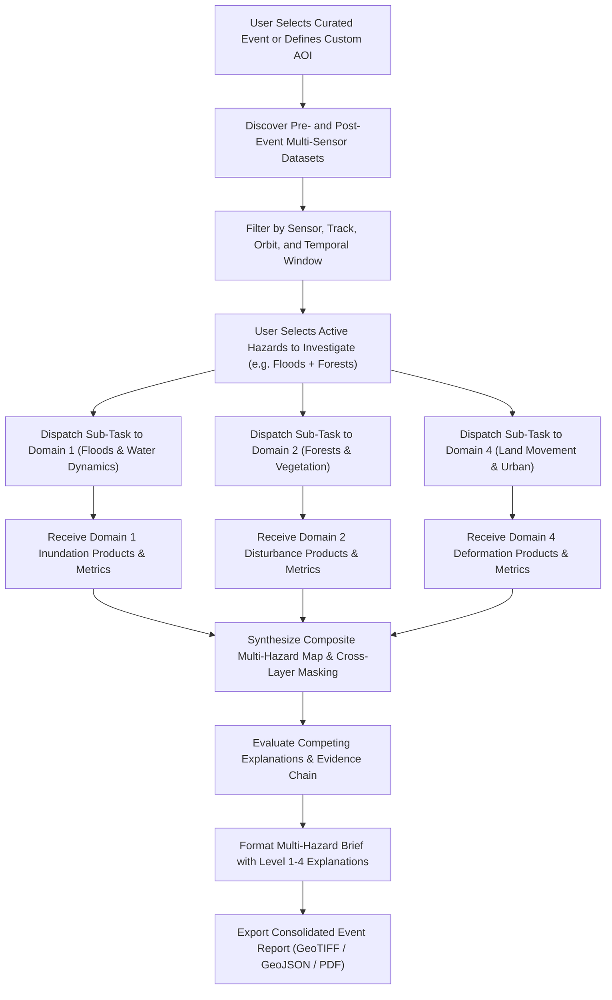

# Earth Event Explorer — Domain Specification & Documentation

## 1. Domain Overview

### Domain Name
**Earth Event Explorer** (The cross-domain integration hub, designated as Domain 6 in Dancing with the SARs).

### Purpose
Provide a unified, multi-sensor event discovery and investigative workspace that allows users to explore major planetary events (hurricanes, volcanic eruptions, earthquakes, ice shelf collapses, and mega-fires) by coordinating and chaining the specialized processing pipelines of the five analytical domains.

### Scientific Problem Being Addressed
Extreme Earth events rarely conform to a single scientific discipline. For example, a major volcanic eruption involves explosive ash plumes that obscure optical sensors, surface lava flows that destroy vegetation (Wildfires & Disturbance), pre- and post-eruptive caldera deflation/inflation (Land Movement), lahars and river damming (Floods & Water Dynamics), and potentially summit ice cap melting (Ice & Cryosphere). Users currently face fragmented scientific portals and siloed tools, preventing rapid multi-hazard assessment and integrated cross-layer Earth system analysis.

### Why SAR is Useful for This Problem
SAR is the premier multi-hazard observation technology:
1. **Weather and Illumination Independence:** Guarantees observation continuity during storms, polar darkness, volcanic ash clouds, and wildfire smoke.
2. **Multi-Physical Observables:** A single SAR sensor simultaneously captures amplitude (surface roughness, moisture, open water), polarimetric decomposition (vegetative canopy volume), and interferometric phase (millimeter crustal deformation).
3. **Multi-Hazard Fusion:** By synthesizing amplitude difference, polarimetric decomposition, and InSAR coherence within a single geospatial viewport, users can observe the complete cascading footprint of complex environmental crises.

### Intended Users
- Interdisciplinary Earth scientists, disaster response coordinators, and humanitarian relief planners.
- Environmental journalists and visual science communicators.
- University educators and students exploring remote sensing physics.
- Geospatial intelligence analysts monitoring global infrastructure disruption.

### Example Questions the User Can Investigate
1. What was the combined spatial footprint of an earthquake-triggered tsunami (inundation + coastal deformation)?
2. Following a hurricane, which sectors suffered from both storm-surge flooding and severe mangrove canopy destruction?
3. Did ground subsidence precede the collapse of an alpine landslide that subsequently dammed a river valley?
4. How do concurrent optical, thermal, and SAR observations compare over an active volcanic eruption?
5. How does a single event evolve across multiple sensor revisits over a 30-day timeline?

### Expected Outputs
- Multi-layer, synchronized event timeline maps.
- Cross-domain investigation briefs summarizing multi-hazard impacts.
- Comprehensive Evidence Chain reports tracing raw observations to derived interpretations.
- Competing Explanations diagnostic cards evaluating alternative physical hypotheses.
- Exportable interactive event presentations and georeferenced data packages.

### Distinctions: Four Levels of Communication
To maintain scientific credibility, the Earth Event Explorer strictly delineates:
1. **Observation:** What the satellite instrument physically measured (raw backscatter $\gamma^0\text{ dB}$, interferometric phase $\phi$, coherence $\gamma$).
2. **Analysis Result:** What the domain algorithm derived (change mask, velocity field, water classification).
3. **Interpretation:** What the scientific evidence suggests (e.g., ground subsidence due to fault slip, canopy loss due to fire).
4. **Uncertainty:** What remains unknown, ambiguous, or unmeasured (e.g., lack of vertical GPS validation, potential soil moisture interference).

---

## 2. Scientific Background

### Cross-Disciplinary Microwave Scattering Principles
The Earth Event Explorer integrates three complementary pillars of radar remote sensing:

```
                      [ Spaceborne SAR Antenna ]
                                  |
             ┌────────────────────┼───────────────────┐
             ▼                    ▼                   ▼
     [ Radiometry / dB ]   [ Polarimetry ]     [ Interferometry ]
             │                    │                   │
             ▼                    ▼                   ▼
        Reflectance           Canopy &            Phase Shift
       Roughness &           Structural            & Crustal
        Dielectric           Scattering           Deformation
             │                    │                   │
             ▼                    ▼                   ▼
      Floods / Water       Vegetation Loss      Subsidence / Ice
```

1. **Radiometric Amplitude Analysis:** Measures backscattering coefficients ($\sigma^0, \gamma^0$). Ideal for surface roughness and dielectric contrasts (open specular water vs. rough terrain, wet vs. dry soil).
2. **Polarimetric Decomposition:** Analyzes scattering behavior across orthogonal polarization channels (HH, HV, VH, VV). Distinguishes surface scattering (bare ground/water), double-bounce (urban structures/flooded trunks), and volume scattering (dense vegetation canopies).
3. **Interferometric SAR (InSAR):** Utilizes phase coherence between repeat orbits. Measures ground surface deformation down to millimeter scales and provides coherence loss metrics to delineate areas of intense physical surface disruption.

### Multi-Sensor Synergy (SAR + Optical + Thermal)
While SAR provides all-weather structural insight, integrating complementary observations resolves ambiguities:
- **Optical (Sentinel-2, Landsat-8/9):** Confirms true color, spectral chlorophyll absorption (NDVI), and burn char indices (dNBR) when cloud-free.
- **Thermal Infrared (MODIS, VIIRS):** Pinpoints active combustion and thermal energy hotspots, confirming whether an observed radar disturbance was caused by wildfire.
- **Digital Elevation Models (Copernicus GLO-30):** Enforces terrain-aware topographic correction and identifies slope-related landslide/flood risks.

---

## 3. Core Features

| Feature | Description | Inputs | Processing or Logic | Expected Output | Priority |
| :--- | :--- | :--- | :--- | :--- | :--- |
| **Curated Event Catalog & Selector** | Pre-indexed library of high-impact global Earth events (hurricanes, quakes, fires, calving). | Event metadata catalog (date, bbox, type, description) | Filtering by hazard category, geographic region, and date range. | Responsive catalog grid with event overview cards. | High (P0) |
| **Geographic AOI & Bounding Box Selector** | Custom coordinate bounding box definition for ad-hoc event investigations. | User coordinates or map polygon draw tool | Spatial query generating bounding box filters for SAR archive search. | Centered map viewport with AOI polygon overlay. | High (P0) |
| **SAR Data Discovery Engine** | Automatically identifies pre- and post-event SAR acquisitions spanning the crisis. | Event AOI, temporal window ($T_{\text{start}} \to T_{\text{end}}$) | API query to ASF DAAC / NASA Earthdata for matching NISAR/Sentinel-1 passes. | List of candidate SAR observation pairs with metadata (orbit, track, mode). | High (P0) |
| **Multi-Date Timeline Scrubber** | Interactive temporal slider scrubbing through sequential satellite revisits. | Multi-temporal image stack | Dynamic layer opacity transition and temporal index switching. | Interactive timeline displaying progressive landscape transformation. | High (P0) |
| **Cross-Domain Analysis Invoker** | Delegates processing tasks to specialized domain modules without duplicating code. | Event dataset, target domain keys (e.g., domain1 + domain5) | Chained execution of domain processors; collection and aggregation of results. | Unified multi-hazard metrics panel and composite layer stack. | High (P0) |

---

## 4. Additional Features

| Feature | Purpose | Required Data | Processing Requirements | Dependencies | Priority |
| :--- | :--- | :--- | :--- | :--- | :--- |
| **Multi-Sensor Composite Viewer** | Side-by-side or curtain comparison of SAR backscatter against optical and thermal layers. | SAR raster, cloud-free Sentinel-2 RGB, FIRMS thermal points | Coordinate alignment, radiometric normalization, multi-layer canvas rendering. | External optical and thermal data availability. | Medium (P1) |
| **Saved Investigations & Workspace State** | Enables researchers to save and share specific event analyses via URL or JSON session files. | Application state (AOI, selected dates, active layers, params) | Client-side serialization to JSON; persistent session storage. | None (frontend state). | Medium (P1) |
| **Cascading Hazard Impact Intersect** | Analyzes compounding impacts (e.g., flood extent overlapping active wildfire burn scars). | Output rasters from $\ge 2$ domain pipelines | Boolean raster intersection ($\text{Flood} \cap \text{BurnScar}$); aggregate hazard area calculation. | Completion of $\ge 2$ domain runs. | Medium (P1) |
| **Automated Investigation Brief Generator** | Generates an executive summary PDF compiling maps, metrics, and evidence levels. | Event metadata, domain results, Level 1-4 text | Client-side / backend document rendering (PDF export). | Formatted domain results. | Low (P2) |

---

## 5. X-Factors and Differentiating Features

### 1. Explainable Event Report & Evidence Chain
- **User Problem Solved:** Decision-makers need to know *why* an algorithm flagged an event, what instrument measured it, and what assumptions were made.
- **Interaction / Workflow:** Clicking "View Evidence Chain" opens an interactive provenance graph linking: Raw Satellite Pass $\to$ Preprocessing Steps $\to$ Derived Thresholds $\to$ Corroborating Datasets $\to$ Final Scientific Finding.
- **Required Data:** Granule IDs, processing timestamps, algorithm versions, parameter logs.
- **Expected Visual Output:** Visual directed acyclic graph (DAG) node diagram with expandable evidence inspector drawers.
- **Processing Requirements:** Complete provenance tracking recorded across all domain executions.
- **Difficulty:** Medium-High.

### 2. Competing Explanations Explorer
- **User Problem Solved:** Prevents confirmation bias by evaluating alternative physical explanations for an observed radar signal.
- **Interaction / Workflow:** User highlights an anomalous change polygon. The system evaluates alternative hypotheses:
  - *Hypothesis A (Deforestation):* Supported by persistent HV drop.
  - *Hypothesis B (Soil Moisture Change):* Weakened by lack of recent rainfall.
  - *Hypothesis C (Seasonal Leaf Drop):* Weakened by comparing historical matching seasons.
- **Required Data:** Multi-temporal SAR stack, precipitation records, phenological baselines.
- **Expected Visual Output:** Diagnostic score card ranking physical hypotheses with supporting and conflicting evidence bars.
- **Processing Requirements:** Rule-based decision tree evaluation.
- **Difficulty:** High.

### 3. SAR Learning Mode
- **User Problem Solved:** Makes radar physics accessible to students, journalists, and non-specialists through interactive micro-tutorials.
- **Interaction / Workflow:** User toggles "Learning Mode". Tooltip pins appear across the SAR image explaining real-world phenomena: "Why is this lake black?", "What causes these rainbow fringes?", "Why do flooded tree trunks look bright yellow?".
- **Required Data:** Educational content library mapped to radar scattering classes.
- **Expected Visual Output:** Contextual explanatory popovers with interactive ray-tracing diagrams.
- **Processing Requirements:** Client-side UI triggers.
- **Difficulty:** Low-Medium.

---

## 6. Explainability

The Earth Event Explorer enforces strict scientific discipline across all findings using the four-level framework:

```
┌────────────────────────────────────────────────────────┐
│ Level 1: Visual Explanation                            │
│  - Multi-sensor layers (SAR dB, Optical RGB, Thermal)  │
│  - Multi-date curtain slider and temporal scrubbers    │
│  - Geographic vector boundaries (watersheds, cities)   │
├────────────────────────────────────────────────────────┤
│ Level 2: Method Explanation                            │
│  - Integrated domain pipelines invoked                 │
│  - Calibration and filtering workflows applied         │
│  - Multi-hazard intersection rules and thresholds      │
├────────────────────────────────────────────────────────┤
│ Level 3: Evidence Explanation                          │
│  - Sensor provenance: NISAR L-SAR, Sentinel-1, MODIS   │
│  - Corroborating indicators: FIRMS thermal, JRC water  │
│  - Exact satellite pass timestamps and orbit tracks    │
├────────────────────────────────────────────────────────┤
│ Level 4: Uncertainty & Caveats                         │
│  - Temporal latency between satellite passes           │
│  - Observational gaps during rapid event phases        │
│  - Unvalidated assumptions and alternative hypotheses  │
└────────────────────────────────────────────────────────┘
```

### Scientifically Responsible Result Explanation Example
> *"Analysis of Hurricane Milton (October 2026) revealed a compound hazard footprint. The Floods & Water Dynamics module delineated $142\text{ km}^2$ of anomalous surface standing water, while the Forests & Vegetation module detected $3,120\text{ hectares}$ of severe canopy structural defoliation along coastal barrier islands. These findings are supported by a mean $14.1\text{ dB}$ specular backscatter reduction over flooded agricultural zones and a $4.8\text{ dB}$ drop in cross-polarized L-band HV backscatter over maritime pine canopies. Caveat: Extreme storm surge water receded rapidly in several suburban tracts between satellite revisits, meaning peak instantaneous inundation extent was likely higher than observed by the post-landfall pass."*

---

## 7. Data Sources and Dataset Requirements

| Dataset or Provider | Relevant Variables or Products | Role | Access Method | Coverage or Limitations | Official Source |
| :--- | :--- | :--- | :--- | :--- | :--- |
| **NASA-ISRO NISAR** | L-band GCOV, GSLC, UNW | Primary high-penetration SAR for deformation, water, and forests | NASA Earthdata / ASF DAAC API | 12-day repeat; global landmass coverage. | [NASA NISAR](https://science.nasa.gov/mission/nisar/) |
| **Copernicus Sentinel-1** | C-band GRD, SLC (10m resolution) | Operational high-frequency SAR baseline | Copernicus Data Space Ecosystem | 6–12 day repeat; global archive since 2014. | [Copernicus](https://dataspace.copernicus.eu/) |
| **Alaska Satellite Facility (ASF) DAAC** | Vertex Search API & HyP3 On-Demand | Discovery and automated preprocessing of SAR products | `asf_search` Python SDK / REST API | Centralized discovery clearinghouse for NASA/ESA SAR data. | [ASF DAAC](https://asf.alaska.edu/) |
| **NASA Earthdata Search** | Global multi-mission Earth observation catalog | Event discovery and cross-mission data access | Earthdata Search API | Universal NASA Earth science repository. | [NASA Earthdata](https://search.earthdata.nasa.gov/) |
| **NASA FIRMS** | Thermal hotspots (MODIS & VIIRS) | Active wildfire thermal verification | FIRMS REST API | Near-real-time global fire detection. | [NASA FIRMS](https://firms.modaps.eosdis.nasa.gov/) |
| **Copernicus Sentinel-2** | Level-2A optical surface reflectance | Cloud-free optical comparison and validation | Copernicus Data Space Ecosystem | 5-day repeat; completely blocked by clouds and smoke. | [Copernicus](https://dataspace.copernicus.eu/) |

---

## 8. Processing Pipeline

The Earth Event Explorer acts as an orchestrator, dispatching tasks to domain modules and synthesizing multi-hazard intelligence:



---

## 9. Technical Architecture

### Frontend Mapping
- **Route:** `/earth-event-explorer` (or designated integration route in `AppRoutes.jsx`).
- **Domain Component:** `frontend/src/domains/earth-event-explorer/EarthEventExplorerPage.jsx` (or integration hub component).
- **Shared Components Reused:**
  - `Navbar` & `Sidebar`: Core site navigation.
  - `DatasetSelector`: Selects event observation dates and sensor passes.
  - `BeforeAfterViewer`: Multi-sensor curtain comparison between SAR and optical/thermal layers.
  - `MetricsPanel`: Synthesizes multi-hazard statistics (total inundated area, canopy loss, peak deformation).
  - `ProcessingStatus`: Monitors multi-pipeline dispatch and completion.

### Backend Coordination
- **API Endpoints:** `backend/app/api/endpoints/explorer.py` (or integrated event routes).
  - `GET /api/events`: Lists curated event catalog entries.
  - `POST /api/events/discover`: Searches for overlapping SAR granules across ASF/Earthdata APIs.
  - `POST /api/events/analyze`: Coordinates multi-domain pipeline execution.
- **Domain Integration:** Calls existing domain processors (`Domain1Processor`, `Domain2Processor`, `Domain3Processor`, `Domain4Processor`, `Domain5Processor`) via their standard interfaces without code duplication.

---

## 10. Inputs, Outputs, and Data Contracts

### Expected Request Payload (`POST /api/events/analyze`)
```json
{
  "event_id": "event-hurricane-milton-2026",
  "aoi_bbox": [-83.5, 26.5, -81.0, 28.5],
  "date_range": ["2026-10-01", "2026-10-15"],
  "requested_domains": ["domain1", "domain2"],
  "params": {
    "domain1": { "threshold_method": "otsu" },
    "domain2": { "disturbance_threshold_db": -3.5 }
  }
}
```

### Expected Response Payload
```json
{
  "event_id": "event-hurricane-milton-2026",
  "status": "completed",
  "summary_metrics": [
    { "label": "Total Flooded Area", "value": "142.0", "unit": "km²" },
    { "label": "Canopy Disturbance Extent", "value": "3120", "unit": "ha" },
    { "label": "Compound Hazard Area", "value": "18.4", "unit": "km²" }
  ],
  "domain_results": {
    "domain1": {
      "status": "completed",
      "output_files": ["outputs/domain1/flood_extent.tif"]
    },
    "domain2": {
      "status": "completed",
      "output_files": ["outputs/domain2/forest_disturbance.tif"]
    }
  },
  "provenance": {
    "orchestrator_version": "0.1.0",
    "execution_timestamp": "2026-10-27T10:00:00Z",
    "granules_analyzed": ["NISAR_L_GCOV_20261002", "NISAR_L_GCOV_20261014"]
  }
}
```

---

## 11. Visualization and UI Requirements

1. **Curated Event Hero Grid:** Visual landing showcase featuring high-profile global Earth events with event summary tags, satellite imagery previews, and "Launch Investigation" buttons.
2. **Synchronized Multi-Hazard Map:** Central map canvas supporting simultaneous toggling of flood layers (blue), forest disturbance (orange), ground subsidence (red), and thermal hotspots (yellow).
3. **Multi-Date Timeline Scrub Bar:** Scrub bar at the bottom of the viewport allowing users to step through time from pre-event baseline through multi-stage crisis progression.
4. **Evidence Chain Drawer:** Slide-out drawer displaying an interactive graph of the satellite observations, algorithms, and validation datasets supporting the active view.
5. **Competing Explanations Inspector:** Diagnostic card displaying alternative physical hypotheses for highlighted anomalies.

---

## 12. Validation and Testing

### Unit and Logic Tests
- `test_event_catalog_schema`: Ensure all curated event entries contain valid coordinates, dates, and non-empty metadata descriptions.
- `test_cross_domain_dispatcher`: Confirm that dispatching requests to multiple domain processors correctly aggregates output files and status flags without hanging.
- `test_compound_hazard_intersection`: Validate that spatial intersection logic correctly handles disparate raster grids and coordinate projections.

### Failure Cases & Scientific Edge Cases
- **Spatial Resolution & Grid Mismatches:** Combining Sentinel-1 ($10\text{m}$), NISAR ($3-10\text{m}$), and MODIS ($250-1000\text{m}$) products can produce spatial alignment and scaling errors. *Mitigation:* Resample all rasters to a standardized common analytical grid during cross-hazard synthesis.
- **Temporal Mismatches:** Comparing a SAR pass taken 6 hours after an event with an optical image acquired 7 days later introduces temporal confounding. *Mitigation:* Display clear acquisition timestamps on all active layers.

---

## 13. Limitations and Scientific Safeguards

1. **No Automated Disaster Severity Claims:** The system provides physical Earth observation measurements; it does not compute monetary losses, casualties, or official disaster declarations.
2. **Correlation is Not Causation:** An observed canopy disturbance near an earthquake rupture zone may be caused by landslide defoliation, or it may represent unassociated agricultural clear-cutting; field validation is required to confirm causation.
3. **Sensor Coverage Gaps:** Satellite constellations have fixed orbital revisit schedules; absence of an observation does not imply absence of an event.

---

## 14. Implementation Roadmap

### Phase 1 — Minimum Viable Domain (MVD)
- [x] Initial documentation and conceptual framework.
- [ ] Curated event catalog JSON with at least 5 representative global events.
- [ ] Event selection UI with basic metadata display.
- [ ] Direct routing links from the event explorer into individual domain screens.
- [ ] Side-by-side before-and-after event visualizer.

### Phase 2 — Scientific Improvement
- [ ] Automated SAR granule discovery query via ASF DAAC API.
- [ ] Cross-domain pipeline orchestrator dispatching jobs to Domain 1 through Domain 5.
- [ ] Multi-date timeline scrub bar.
- [ ] Level 1–4 automated explainability generator.

### Phase 3 — Advanced Features
- [ ] Interactive Evidence Chain DAG visualizer.
- [ ] Competing Explanations diagnostic hypothesis tester.
- [ ] Multi-sensor overlay viewer (SAR + Sentinel-2 optical + FIRMS thermal).
- [ ] Exportable executive event investigation report.

---

## 15. Acceptance Criteria

- [ ] User can browse and select curated events from the catalog or draw a custom AOI.
- [ ] The platform identifies and lists suitable pre- and post-event SAR observation pairs.
- [ ] The user can trigger multi-hazard analyses that successfully invoke underlying domain processors.
- [ ] Output layers from multiple domains render accurately on a synchronized geospatial map.
- [ ] The UI transparently presents the 4-level explainability breakdown and evidence provenance.
- [ ] Competing explanations and scientific caveats are explicitly surfaced.

---

## 16. References

### Official Data Documentation
- [NASA NISAR Mission Science & Applications](https://science.nasa.gov/mission/nisar/)
- [NASA Earthdata Search Documentation](https://search.earthdata.nasa.gov/)
- [Alaska Satellite Facility (ASF) DAAC API Guides](https://asf.alaska.edu/api/)
- [Copernicus Data Space Ecosystem Documentation](https://dataspace.copernicus.eu/)
- [NASA FIRMS Data Provider Information](https://firms.modaps.eosdis.nasa.gov/)

### Scientific Methodology References
- Joyce, K. E., et al. (2009). *A review of the status of satellite remote sensing and image processing techniques for mapping natural hazards and disasters.* Progress in Physical Geography, 33(2), 183–207.
- Voigt, S., et al. (2016). *Global trends in satellite-based emergency mapping.* Science, 353(6296), 247–252.
- Tralli, D. M., et al. (2005). *Satellite remote sensing of earthquake, volcano, flood, landslide and tsunami hazards.* ISPRS Journal of Photogrammetry and Remote Sensing, 59(4), 185–198.

### Internal Project Specifications
- [Platform Architecture Overview](../../architecture.md)
- [API Contracts and Data Interfaces](../../api-contracts.md)
- [Dataset Storage & Inventory](../../dataset-inventory.md)
- [Domain 1: Floods & Water Dynamics](../floods-water-dynamics/README.md)
- [Domain 2: Forests & Vegetation](../forests-vegetation/README.md)
- [Domain 3: Ice, Glaciers & Cryosphere](../ice-glaciers-cryosphere/README.md)
- [Domain 4: Land Movement & Urban Change](../land-movement-urban-change/README.md)
- [Domain 5: Wildfires & Land Disturbance](../wildfires-land-disturbance/README.md)
