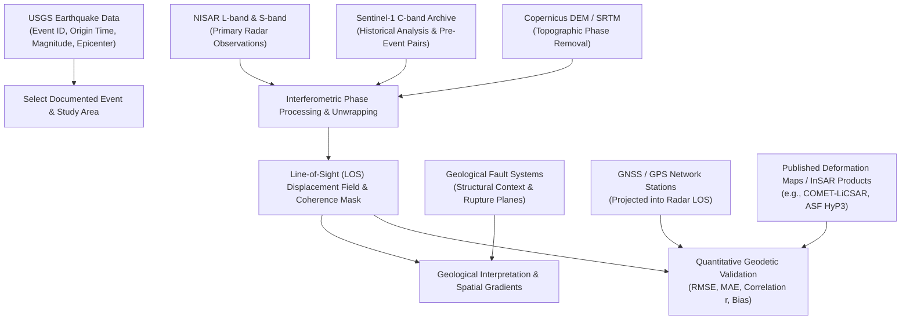
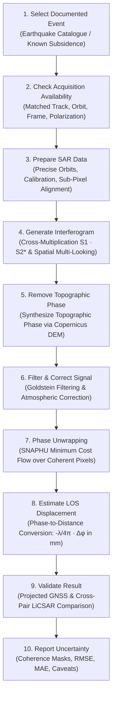

# Domain 3: Earthquakes & Ground Deformation — Specification & Documentation
**Dataset Selection, InSAR Processing & Validation Strategy for Dancing with the SARs**

Welcome to the comprehensive scientific, architectural, and operational specification for **Domain 3: Earthquakes & Ground Deformation** of the **NISAR — Dancing with the SARs** platform.

---

## 1. Executive Summary & Objective

- **Domain Identifier:** `domain3`
- **Domain Name:** **Earthquakes & Ground Deformation**
- **Assigned Role:** **Team Member 3 — InSAR Deformation and Seismic Displacement Analysis**
- **Objective:** Use Synthetic Aperture Radar (SAR) observations to detect, measure, and validate changes in Earth’s surface caused by earthquakes, tectonic movement, ground subsidence, and other deformation processes.
- **Central Technique:** **Interferometric SAR (InSAR)**. InSAR compares the phase of radar observations acquired over the same geographical location at different times to estimate millimeter-scale changes in the distance between the ground and the satellite along the radar’s Line of Sight (LOS).
- **Primary Deliverable:** Validated ground-deformation maps, LOS displacement measurements, coherence reliability masks, uncertainty information, and empirical comparisons against independent geodetic observations.

---

## 2. Dataset Combination Strategy

For reliable and scientifically defensible results, the platform employs a multi-tier dataset combination where each dataset serves a distinct, non-interchangeable role:

$$\text{NISAR} + \text{Sentinel-1} + \text{GNSS/GPS} + \text{USGS Earthquake Data} + \text{DEM} + \text{Geological Fault Data} + \text{Independent Deformation Measurements}$$



### Dataset Roles & Physical Functions

| Dataset | Primary Role in Domain 3 | Why It Is Distinct & Essential |
| :--- | :--- | :--- |
| **NISAR L-band & S-band** | Primary radar observations for measuring coseismic and inter-seismic surface displacement. | L-band microwave pulses ($\lambda \approx 24\text{ cm}$) maintain interferometric coherence across vegetated landscapes far better than shorter wavelengths, enabling deformation measurements in rural and agricultural fault zones where C-band decorrelates. |
| **Sentinel-1 C-band** | Historical deformation analysis and InSAR algorithm development using an extensive multi-year archive. | Consistent 6-to-12 day revisit orbit tracks (2014–present) provide the historical baseline needed to separate long-term inter-seismic strain accumulation from acute coseismic rupture. |
| **GNSS / GPS Observations** | Independent point measurements of continuous 3D ground motion at instrument stations. | Ground-based geodetic benchmark measuring absolute ground movement; when projected into the satellite LOS, provides independent ground truth for accuracy assessment. |
| **USGS Earthquake Catalogue** | Event identification, timing, hypocenter coordinates, and magnitude ($M_w$). | Identifies the physical earthquake event and bounds the temporal window for baseline vs. post-event radar pair selection. *Does not measure spatial displacement fields.* |
| **DEM (Copernicus GLO-30 / SRTM)** | Topographic phase removal and geometric terrain correction. | Separates topographic phase contributions ($\phi_{\text{topo}}$) from true surface displacement phase ($\phi_{\text{disp}}$). |
| **Geological Fault Data** | Tectonic structural context (mapped fault traces, dip angles, slip regimes). | Identifies known fault systems to determine whether observed deformation gradients align with mapped active tectonic structures. |
| **Published Deformation Maps** | Independent cross-interferogram or external geodetic comparison. | Authoritative processed products (e.g., COMET-LiCSAR, ASF HyP3, university geodetic groups) supporting cross-chain consistency verification. |

> [!IMPORTANT]
> **Complementary Roles Notice:**
> - **USGS earthquake records** *identify the event* but do not map ground displacement.
> - **GNSS observations and published deformation products** *validate the satellite measurements*.
> - **Geological fault maps** *provide structural context*.
>
> These datasets are strictly complementary and must never be treated as interchangeable.

---

## 3. Detailed Dataset Assessment Matrix

| Dataset | Primary Purpose | What We Can Obtain | Main Limitation |
| :--- | :--- | :--- | :--- |
| **NISAR** | Primary radar analysis | Radar phase and amplitude observations for measuring surface deformation | Suitable acquisitions before and after the event must be available in the public archive. |
| **Sentinel-1** | Historical radar analysis | Extensive pre- and post-event SAR acquisitions for interferometric processing | C-band ($\lambda \approx 5.6\text{ cm}$) suffers from temporal decorrelation over dense vegetation and is sensitive to tropospheric water vapor. |
| **GNSS / GPS** | Independent geodetic validation | Continuous 3D displacement vectors at discrete instrument locations | Stations are spatially sparse and frequently absent in remote epicentral regions. |
| **USGS Earthquake Catalogue** | Event identification & bounds | Origin time, epicenter coordinates, focal depth, magnitude ($M_w$), and moment tensor | Point-source parameter estimates only; does not provide a spatial map of surface deformation. |
| **Copernicus DEM / SRTM** | Topographic phase removal | High-resolution elevation and terrain morphology ($30\text{ m}$) | DEM errors or steep elevation artifacts can introduce phase residuals into the deformation signal. |
| **Geological Fault Datasets** | Tectonic interpretation | Surface fault traces, slip mechanisms, and tectonic boundaries | Mapped fault databases may be incomplete, unmapped at depth, or carry positional uncertainties. |
| **Published Deformation Maps** | Independent comparison | Independent unwrapped LOS displacement grids and published models | Coverage, unwrapping methods, reference tie points, and spatial resolutions may differ. |

### Dataset Selection Priorities

- **Priority 1 — Essential:**
  1. Suitable SAR acquisitions before and after the event with matched orbital geometry.
  2. A documented earthquake or ground-deformation event from an authoritative seismic catalogue.
  3. A high-resolution Digital Elevation Model (Copernicus DEM GLO-30 or SRTM).
  4. A method for validating the resulting displacement estimates.
- **Priority 2 — Strongly Recommended:**
  1. GNSS / GPS observations located within or adjacent to the study area.
  2. Geological fault database overlays (e.g., USGS Quaternary Faults, regional active fault databases).
  3. Independent deformation measurements or cross-pair interferograms.
- **Priority 3 — Additional Context:**
  1. High-resolution optical imagery for identifying surface ruptures, landslides, and infrastructure damage.
  2. Regional geological maps and land-cover rasters.
  3. Additional multi-temporal SAR observations to track post-seismic relaxation and fault creep.

---

## 4. What We Measure & Physical Principles

The project focuses on **empirically measurable geophysical quantities** rather than simple qualitative radar visualization.

### A. Line-of-Sight (LOS) Displacement
InSAR measures changes in the sensor-to-ground distance along the radar's 1-dimensional Line of Sight:

$$\Delta \phi_{\text{disp}} = -\frac{4\pi}{\lambda} \cdot \Delta R_{\text{LOS}}$$

Where $\lambda$ is radar wavelength ($24.0\text{ cm}$ for NISAR L-band, $5.55\text{ cm}$ for Sentinel-1 C-band) and $\Delta R_{\text{LOS}}$ is relative displacement along the slant range.

- **Negative Values ($\Delta R > 0$):** Movement away from the satellite (ground subsidence, normal fault downthrow, or eastward motion on an ascending track).
- **Positive Values ($\Delta R < 0$):** Movement toward the satellite (surface uplift, reverse fault thrusting, or westward motion on an ascending track).
- **Deliverables:** Continuous unwrapped displacement raster ($\text{mm}$), maximum measured subsidence, peak uplift, and spatial area of subsidence hotspots exceeding critical thresholds.

> [!WARNING]
> **Viewing Geometry Limitation:**
> A single viewing geometry measures only the 1D Line-of-Sight projection. It does **not** independently resolve 3D ground motion (vertical vs. east-west vs. north-south). Resolving full 3D displacement vectors requires combining both ascending and descending orbit tracks with known azimuth and incidence angles ($\theta$).

### B. Spatial Deformation Patterns
The platform evaluates spatial variations across the displacement field:
- **Coseismic Displacement Gradients:** Sharp discontinuities in unwrapped phase delineating surface fault rupture planes.
- **Subsidence Hotspot Bowls:** Spatially coherent elliptical depression bowls characteristic of aquifer overdraft, mining collapse, or hanging-wall normal fault drop.
- **Coherence Quality Masking:** Interferometric coherence ($\gamma \in [0, 1]$) evaluates local phase stability:
  $$\gamma = \frac{|\sum S_1 \cdot S_2^*|}{\sqrt{\sum |S_1|^2 \cdot \sum |S_2|^2}}$$
  Pixels with $\gamma < 0.35$ are masked as noisy and decorrelated, ensuring measurements are not reported where vegetation or surface disruption corrupts the phase.

### C. Multi-Temporal Evolution
When multiple SAR passes are available, the platform analyzes temporal progression:
- **Pre-Event Baseline:** Quantifies pre-existing tectonic strain accumulation or background subsidence rates.
- **Coseismic Step:** Isolates the instantaneous displacement jump produced during the mainshock.
- **Post-Seismic Relaxation:** Identifies continuing afterslip, fault re-locking, or poroelastic fluid drainage.

---

## 5. Recommended 10-Step Processing Workflow



1. **Select a Documented Event:** Choose an earthquake or subsidence case with documented parameters from the USGS or regional seismic networks.
2. **Check Acquisition Availability:** Verify that suitably matched SAR acquisitions exist before and after the event. Confirm identical orbit geometry (track and frame).
3. **Prepare the SAR Data:** Ingest Single Look Complex (SLC) or geocoded unwrapped products (e.g. COMET-LiCSAR, ASF HyP3 GUNW), apply precise orbit ephemerides, and verify sub-pixel co-registration.
4. **Generate the Interferogram:** Cross-multiply pre- and post-event complex radar signals to obtain the raw interferometric phase and multi-look intensity.
5. **Remove Topographic Effects:** Ingest Copernicus DEM GLO-30 or SRTM to simulate and subtract the terrain-induced phase contribution.
6. **Correct and Filter the Signal:** Apply adaptive spatial phase filtering (e.g., Goldstein-Werner filter) to suppress phase noise while preserving sharp fringe boundaries.
7. **Unwrap the Phase:** Convert $2\pi$-wrapped interferometric fringes into a continuous displacement field using Statistical-Cost Network-Flow Phase-Unwrapping (SNAPHU) restricted to coherent pixels ($\gamma \ge 0.35$).
8. **Estimate LOS Displacement:** Convert continuous unwrapped phase into metric displacement units ($\text{mm}$) using the radar wavelength ($\lambda$).
9. **Validate the Result:** Benchmark satellite displacement against independent projected GNSS vectors or independent cross-pair interferograms.
10. **Report Uncertainty:** Display displacement maps alongside interferometric coherence, residual error heatmaps, and transparent caveats identifying decorrelated regions.

> [!CAUTION]
> **Technical Caution:**
> Interferometric phase differences do not automatically equal ground displacement. Orbital ramps, tropospheric water vapor delays, ionospheric turbulence, DEM errors, and phase unwrapping ambiguities ($2\pi$ cycle slips) can corrupt the signal. Rigorous validation against independent observations is non-negotiable.

---

## 6. Validation Methodology & Quantitative Metrics

A visually convincing interferogram is insufficient for scientific credibility. The platform quantitatively evaluates displacement estimates against independent reference data.

### Validation Methods

| Validation Method | What It Checks |
| :--- | :--- |
| **GNSS / GPS Comparison** | Agreement between satellite-derived LOS displacement and continuous ground-based GPS stations after projecting 3D GPS vectors into the satellite LOS direction: $d_{\text{LOS}} = -u_e \sin\theta \cos\alpha + u_n \sin\theta \sin\alpha + u_u \cos\theta$. |
| **Published Deformation Maps** | Consistency of spatial displacement patterns, fault offset magnitude, and subsidence bowl perimeters with independently processed InSAR solutions (e.g., COMET-LiCSAR, ASF HyP3). |
| **Interferometric Coherence** | Pixel-level phase stability ($\gamma \ge 0.35$) confirming that radar signals retained sufficient correlation for reliable phase measurement. |
| **Before-and-After Comparison** | Temporal consistency verifying that displacement occurred strictly across the coseismic window rather than accumulating as a slow secular artifact. |
| **Fault & Geological Comparison** | Alignment of displacement gradients and sense of slip (normal, thrust, strike-slip) with mapped geological fault structures. |
| **Uncertainty & Residual Analysis** | Evaluation of residual errors ($d_{\text{meas}} - d_{\text{ref}}$) to verify spatial uniformity and isolate localized cycle slips. |

### Quantitative Metrics Reported

When comparable continuous reference data are available, the platform calculates:

1. **Mean Absolute Error (MAE):** Average absolute difference between estimated and reference displacement:
   $$\text{MAE} = \frac{1}{N} \sum_{i=1}^{N} |d_{\text{meas}, i} - d_{\text{ref}, i}|$$
2. **Root Mean Square Error (RMSE):** Error metric penalizing large localized phase discrepancies or cycle slips:
   $$\text{RMSE} = \sqrt{\frac{1}{N} \sum_{i=1}^{N} (d_{\text{meas}, i} - d_{\text{ref}, i})^2}$$
3. **Pearson Correlation Coefficient ($r$):** Statistical agreement measuring how closely estimated and reference displacement patterns vary together ($r \to 1.0$ indicates near-perfect spatial correlation):
   $$r = \frac{\sum (d_{\text{meas}} - \bar{d}_{\text{meas}})(d_{\text{ref}} - \bar{d}_{\text{ref}})}{\sqrt{\sum (d_{\text{meas}} - \bar{d}_{\text{meas}})^2 \sum (d_{\text{ref}} - \bar{d}_{\text{ref}})^2}}$$
4. **Mean Bias:** Systematic offset between measured and reference fields:
   $$\text{Bias} = \frac{1}{N} \sum_{i=1}^{N} (d_{\text{meas}, i} - d_{\text{ref}, i})$$
5. **Valid-Pixel Coverage:** Percentage of the study area retaining coherence ($\gamma \ge 0.35$) and valid unwrapped phase.

---

## 7. Data Quality & Metadata Requirements

To ensure full reproducibility, every dataset and processing run records a mandatory 12-point provenance record:

- [x] **Dataset Name & Provider:** Official mission and repository identifier.
- [x] **Sensor & Acquisition Epochs:** Satellite platform, primary pass date, repeat pass date.
- [x] **Product Identifier & Processing Level:** Exact granule name (e.g. `102A_04971_141314 / 20210225_20210309.geo.unw.tif`).
- [x] **Spatial Coverage & Bounding Box:** WGS84 bounding coordinates $[W, S, E, N]$.
- [x] **Coordinate Reference System:** EPSG code (e.g., `EPSG:4326` or UTM zone).
- [x] **Orbit Direction & Geometry:** Ascending vs. descending track, frame number, incidence angle ($\theta$).
- [x] **Radar Parameters:** Frequency band, center wavelength ($\lambda$), polarization (VV, HH).
- [x] **DEM Source & Resolution:** Elevation dataset name and spatial posting ($30\text{ m}$).
- [x] **InSAR Algorithm & Parameters:** Coherence threshold ($\gamma \ge 0.35$), subsidence threshold ($\text{mm}$), filter kernel.
- [x] **Coherence & Quality Masks:** Binary raster isolating high-coherence pixels from decorrelated areas.
- [x] **Reference Validation Metadata:** Reference dataset ID, independence classification tier, and comparison units.
- [x] **Uncertainty & Known Limitations:** Transparent documentation of look angle, line of sight, and unmodeled atmospheric noise.

---

## 8. Verified Real-Data Case Study: Tyrnavos $M_w\ 6.3$ Earthquake

The platform includes a fully verified, real InSAR case study:

- **Seismic Event:** 3 March 2021 $M_w\ 6.3$ Tyrnavos / Elassona Normal Fault Earthquake (Thessaly, Greece).
- **Primary InSAR Pair:** COMET-LiCSAR Sentinel-1A Track 102A unwrapped coseismic interferogram spanning 12 days (`2021-02-25` $\to$ `2021-03-09`).
- **Wavelength & Units:** $5.55\text{ cm}$ C-band, converted from radians to Line-of-Sight displacement ($\text{mm}$).
- **Coherence Quality Filter:** Interferometric coherence mask $\gamma \ge 0.35$.
- **Observed Peak Subsidence:** $-368.5\text{ mm}$ ($36.8\text{ cm}$) downthrow on the hanging wall of the Tyrnavos normal fault.
- **Subsidence Hotspot Footprint:** $14.2\text{ km}^2$ experiencing displacement $\le -80.0\text{ mm}$.
- **Independent Validation Reference:** 18-day Sentinel-1B/1A interferogram (`2021-02-19` $\to$ `2021-03-09`, LiCSAR Frame `102A_04971_141314`).
- **Quantitative Accuracy Results:**
  - **$\text{RMSE} = 4.99\text{ mm}$**
  - **$\text{MAE} = 3.65\text{ mm}$**
  - **$\text{Correlation } r = 0.999$**
  - **$\text{Mean Bias} = -1.22\text{ mm}$**
- **Reference Independence Classification:** `partially_independent_cross_pair` (*Partially Independent Cross-Interferogram Comparison sharing a common post-seismic epoch and LiCSAR processing chain*).

---

## 9. Backend API Contract & Deliverables

### Endpoint: `POST /api/domains/domain3/process`

```json
{
  "inputs": {
    "displacement": "ds-real-d4-disp",
    "coherence": "ds-real-d4-coh",
    "reference_displacement": "ds-real-d4-ref",
    "exposure_assets": "ds-real-d4-exp"
  },
  "parameters": {
    "min_coherence": 0.35,
    "subsidence_threshold_mm": -80.0,
    "color_stretch_mm": 300.0
  }
}
```

### Deliverable Files in `data/outputs/domain3/{run_id}/`:
- `displacement_filtered.tif`: Georeferenced unwrapped Line-of-Sight displacement GeoTIFF ($\text{mm}$, masked at $\gamma < 0.35$).
- `coherence_mask.png`: Visual grayscale preview of interferometric coherence ($0.0 \to 1.0$).
- `displacement_map.png`: Symmetric diverging color ramp preview (red = subsidence away from sensor, blue = uplift toward sensor).
- `subsidence_hotspots.png`: High-contrast hotspot overlay identifying parcels exceeding the subsidence threshold.
- `validation_residuals.tif`: Pixel-by-pixel difference map ($d_{\text{meas}} - d_{\text{ref}}$ in $\text{mm}$).
- `validation_agreement.png`: Residual error heatmap.
- `run_metadata.json`: Complete 15-section scientific provenance, metrics, and validation record.

---

## 10. Scientific Caveats & Safeguards

1. **1D Line-of-Sight Geometry:** Radar displacement is measured along the slant range line of sight, not pure vertical subsidence. Resolving 3D displacement vectors requires combining ascending and descending orbits.
2. **Atmospheric Delays:** Tropospheric water vapor turbulence can introduce centimeter-scale long-wavelength phase ramps that mimic tectonic tilt if not corrected using weather models (e.g. GACOS).
3. **Vegetation Decorrelation:** Dense, moving vegetation destroys interferometric phase correlation. C-band cannot reliably unwrap phase in heavily vegetated rural areas, whereas NISAR L-band penetrates canopies to preserve coherence.
4. **Phase Unwrapping Ambiguities:** In zones of steep displacement gradients or low coherence, phase unwrapping algorithms can produce integer $2\pi$ phase jumps (cycle slips), distorting displacement estimates by integer multiples of $\lambda/2$.
5. **Cross-Pair Reference Independence:** Comparing an interferogram against another pair from the same track sharing an epoch provides an essential cross-interferogram consistency check, but does not substitute for independent non-InSAR ground truth (e.g. GNSS).

---

## 11. References

- [NASA NISAR Mission Science & Applications](https://science.nasa.gov/mission/nisar/)
- [Alaska Satellite Facility (ASF) DAAC InSAR User Guide](https://asf.alaska.edu/data-tools/hyp3/)
- [COMET-LiCSAR Sentinel-1 InSAR Portal](https://comet.nerc.ac.uk/COMET-LiCS-portal/)
- [USGS Earthquake Hazards Program](https://earthquake.usgs.gov/)
- Chen, C. W., & Zebker, H. A. (2001). *Two-dimensional phase unwrapping with use of statistical-cost network-flow approaches.* JOSA A, 18(2), 338–347.
- Goldstein, R. M., & Werner, C. L. (1998). *Radar interferogram filtering for geophysical applications.* Geophysical Research Letters, 25(21), 4035–4038.
