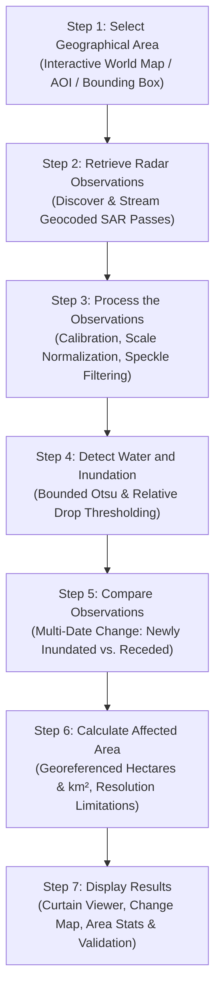

# Domain 1: Floods & Wetlands — Specification & Documentation
**Team Member 1 — Radar-Based Water and Inundation Monitoring**

Welcome to the comprehensive scientific, architectural, and operational specification for **Domain 1: Floods & Wetlands** of the **NISAR — Dancing with the SARs** platform.

---

## 1. Executive Summary & Objective

- **Domain Identifier:** `domain1`
- **Domain Name:** **Floods & Wetlands**
- **Assigned Role:** **Team Member 1 — Radar-Based Water and Inundation Monitoring**
- **Objective:** Develop a radar-based monitoring module that identifies and quantifies changes in surface inundation and wetland extent using suitable Synthetic Aperture Radar (SAR) observations.
- **Primary Output:** Georeferenced inundation maps, multi-date change maps, area statistics, and independent validation results.
- **Main Technical Challenge:** Correctly distinguishing inundated land from other surfaces under varying terrain, vegetation cover, surface roughness, and radar acquisition conditions.
- **Primary Dependency:** Access to suitable repeat-pass SAR observations for the selected region and dates.

---

## 2. What Problem Does This Domain Solve?

Floods represent one of the most frequent, disruptive, and destructive natural hazards on Earth. Floods can cover roads, agricultural fields, settlements, and ecologically critical wetlands.

### The Limitation of Conventional Optical Imagery
Conventional optical satellite imagery (e.g., Landsat, Sentinel-2, MODIS) struggles to observe the surface when cloud cover, heavy precipitation, smoke, or nighttime obscure the affected region. During catastrophic flood events (e.g., monsoons, tropical cyclones, atmospheric rivers), continuous overcast conditions often persist for days or weeks—precisely when emergency situational awareness is most urgent.

### Why SAR Solves This Problem
Active Synthetic Aperture Radar (SAR) transmits microwave pulses that penetrate clouds, haze, rain, and atmospheric smoke, operating completely independent of solar illumination:
1. **Specular Reflection Over Open Water:** Smooth, calm standing water acts as a mirror-like specular reflector. Transmitted microwave energy bounces away from the sensor line-of-sight, resulting in distinctly low radar backscatter (dark pixels, typically $\sigma^0 < -18\text{ dB}$).
2. **Flooded Vegetation Double-Bounce:** While open water darkens radar returns, standing water beneath vegetation canopies (flooded forests, reeds, emergent marsh wetlands) produces a classic "double-bounce" reflection between tree trunks/stems and the underlying water surface. Longer radar wavelengths—most notably **NISAR L-band** ($24\text{ cm}$)—readily penetrate leafy canopies to interact with sub-canopy water, producing enhanced bright backscatter that optical satellites cannot see.
3. **Wetland Hydrological Cycles:** Wetlands undergo dynamic seasonal inundation, hydroperiod expansion, and dry-down cycles. SAR provides an all-weather, repeatable measurement capability to monitor long-term wetland stability and human encroachment.

### Two Related Investigation Focus Areas
1. **Flood Monitoring:** Where has inundation occurred, how has its spatial extent changed between dates, and what infrastructure or agricultural assets are exposed?
2. **Wetland Monitoring:** How are the extent, boundary dynamics, and inundation patterns of wetlands changing over time?

---

## 3. The 7-Step Module Workflow

The module follows a rigorous 7-step operational workflow:



### Step 1 — Select a Geographical Area
The user selects a region of interest (AOI) on the interactive world map (`/earth-event-explorer` or `/domain1`). They can search for named study areas (e.g., `"Lake Karla, Greece"`), click preset disaster case studies, enter custom bounding-box coordinates, or upload a GeoJSON area of interest.

### Step 2 — Retrieve Radar Observations
The system searches and retrieves suitable geocoded SAR observations for the selected region and dates.
- Primary radar sources: **NISAR L-band** (L-SAR) and **Sentinel-1 C-band** (C-SAR) RTC (Radiometric Terrain Corrected) backscatter products.
- Requires paired pre-event (baseline) and post-event (monitoring) passes with matching orbital geometry and polarization (VV, VH, or HH).

### Step 3 — Process the Observations
The system prepares the radar observations for analysis, accounting for calibration, coordinate reference systems (CRS), spatial alignment, and radiometric scale:
- Verifies spatial overlap and re-projects/resamples monitoring rasters to align pixel-for-pixel with the baseline grid.
- Converts digital numbers or linear power amplitudes to decibels ($\text{dB} = 10 \cdot \log_{10}(\text{power})$).
- Applies spatial boxcar or adaptive speckle filtering (e.g., $3\times3$ or $5\times5$ window) to suppress granular radar speckle noise while preserving sharp water boundaries.

### Step 4 — Detect Water and Inundation
The system analyses radar backscatter to distinguish likely water-covered pixels from surrounding terrestrial land:
- **Bounded Otsu Histogram Thresholding:** Computes the optimal bimodal separation between the dark water peak and the brighter terrestrial peak, bounded within a physically realistic water threshold range (e.g., $-22\text{ dB}$ to $-14\text{ dB}$).
- **Relative Backscatter Drop ($\Delta\text{dB}$):** Enforces a minimum relative drop (e.g., $\text{Baseline} - \text{Event} \ge 3.0\text{ dB}$) to ensure detected pixels genuinely darkened during the event rather than permanently dark smooth sand or asphalt.
- **Terrain Slope Filtering:** Ingests a Digital Elevation Model (Copernicus DEM GLO-30 or SRTM) to compute terrain slope, masking candidate pixels on steep terrain ($>5^\circ$) where standing water cannot physically accumulate and where mountain radar shadow causes dark false positives.
- **Permanent Water Masking:** Ingests baseline water masks (e.g., EC JRC Global Surface Water v1.3 or pre-event baseline water) to separate permanent lakes, rivers, and reservoirs from temporary, anomalous floodwater.

### Step 5 — Compare Observations
The system compares multi-date observations to track the spatial progression of floodwater:
- **Newly Inundated Area:** Pixels classified as dry land in the earlier observation and water in the later observation.
- **Persistent Water:** Pixels classified as water in both acquisitions (permanent water bodies or long-duration inundation).
- **No-Longer-Inundated (Receded) Area:** Pixels classified as water in the earlier observation and dry in the later observation, mapping flood drainage and recovery.

### Step 6 — Calculate the Affected Area
The system calculates georeferenced areas represented by classified pixels:
- Accounts for geographic latitude-dependent pixel scaling (converting EPSG:4326 degrees to true metric surface area or utilizing native projected UTM metric pixels).
- Applies morphological cluster sieving (Minimum Mapping Unit / MMU, e.g. 5 pixels) to remove isolated false positives.
- Reports estimated inundated area in both **hectares** and **square kilometers ($\text{km}^2$)**, alongside spatial resolution and sensor geometry caveats.

### Step 7 — Display the Results
The user interacts with a comprehensive visual dashboard:
- **Interactive Before-and-After Curtain Swipe Viewer:** Direct visual overlay comparing the pre-flood SAR baseline and post-flood observation.
- **Inundation Classification Overlay:** Color-coded classification map showing permanent water (navy) and detected flood inundation (cyan).
- **Backscatter Change Map ($\Delta\text{dB}$):** Continuous diverging color ramp highlighting microwave attenuation.
- **Summary Metrics & Area Statistics:** Total evaluated area, newly inundated extent, permanent water area, and percentage increase.
- **Validation & Error Explorer Panel:** Confusion matrix (IoU, Precision, Recall, F1) against independent reference data when available.
- **4-Level Explainability & Caveats:** Transparent scientific documentation explaining physical mechanisms, assumptions, and uncertainty bounds.

---

## 4. Recommended Dataset Combination

To achieve rigorous scientific monitoring, this domain utilizes a multi-sensor dataset combination where **each dataset serves a distinct, non-interchangeable purpose**:

$$\text{NISAR} + \text{Sentinel-1} + \text{Sentinel-2} + \text{Landsat} + \text{NASA GPM} + \text{DEM} + \text{Independent Reference}$$

| Dataset | Sensor / Platform | Primary Role in Domain 1 | Why It Is Distinct & Essential |
| :--- | :--- | :--- | :--- |
| **NISAR L-SAR & S-SAR** | NASA-ISRO SAR ($24\text{ cm}$ L-band / $9.3\text{ cm}$ S-band) | Primary L-band microwave observations for detecting changes in surface inundation and sub-canopy wetland water. | L-band penetrates dense wetland vegetation canopies to detect sub-canopy standing water via trunk double-bounce reflection where optical and C-band signals attenuate. |
| **Sentinel-1 C-SAR** | Copernicus Sentinel-1A/1B ($5.6\text{ cm}$ C-band) | Historical flood analysis, algorithm development, and cross-frequency comparison with NISAR. | High-frequency 6-to-12 day historical archive (2014–present) allows long-term wetland dynamic analysis and algorithm calibration. |
| **Sentinel-2 MSI** | Copernicus Sentinel-2A/2B (Optical/SWIR, $10\text{--}20\text{ m}$) | Optical evidence of surface water via NDWI/MNDWI when cloud conditions permit. | Provides independent cross-sensor optical spectral confirmation to validate radar water boundaries without radar-specific roughness artifacts. |
| **Landsat (5/7/8/9)** | NASA/USGS Landsat OLI/TIRS (Optical/Thermal, $30\text{ m}$) | Decadal historical optical observations for examining long-term baseline water extent and post-flood dry-down. | Supplies 40+ year historical baseline context for wetland permanence, seasonal lake fluctuations, and historical flood extents. |
| **NASA GPM (IMERG)** | NASA Global Precipitation Measurement Mission | Multi-satellite precipitation estimates to establish rainfall and meteorological context around flood events. | Corroborates that detected surface water surges coincide with documented extreme precipitation anomalies, ruling out unseasonal irrigation or dam releases. |
| **Digital Elevation Model (DEM)** | Copernicus DEM GLO-30 / NASA SRTM ($30\text{ m}$) | Terrain elevation and slope analysis to interpret flood drainage and eliminate mountain false positives. | Standing floodwater cannot persist on steep terrain. Slope filtering ($>5^\circ$) eliminates mountain radar shadow false detections and enables Height Above Nearest Drainage (HAND) modeling. |
| **Independent Reference Data** | Official emergency maps (Copernicus EMS), field surveys, or validated optical NDWI perimeters | Ground-truth and benchmark evaluation for precision, recall, IoU, and F1 accuracy scoring. | Enables objective, empirical validation of radar classification performance against authoritative non-SAR observations. |

> [!IMPORTANT]
> **Data Role Integrity Notice:**
> - **NISAR and Sentinel-1** are *active microwave radar sources* capable of all-weather surface roughness and dielectric sensing.
> - **Sentinel-2 and Landsat** provide *passive optical multispectral reflectance evidence*.
> - **NASA GPM** provides *meteorological rainfall context*.
> - **Copernicus DEM / SRTM** describes *physical terrain morphology*.
> - **Independent reference data** evaluate *empirical accuracy*.
>
> These datasets serve fundamentally different physical purposes and must never be treated as interchangeable or fabricated.

---

## 5. Scientific Methods & Technical Challenges

### Key Algorithms & Methods

| Method | Scientific Purpose | Implementation in Platform |
| :--- | :--- | :--- |
| **Radar Backscatter Analysis** | Identify radar responses consistent with water or inundation. | Converts amplitude/power to calibrated decibels ($\sigma^0\text{ dB}$); evaluates co-polarized (VV/HH) specular drop and cross-polarized (VH) volume scattering. |
| **Threshold-Based Classification** | Separate likely water-covered pixels from surrounding terrestrial land. | Bounded Otsu automated histogram separation constrained to physically verified water decibel bounds ($-22\text{ to }-14\text{ dB}$) plus minimum relative drop ($\ge 3.0\text{ dB}$). |
| **Multi-Date Change Detection** | Identify where the classification changes between observations. | Matrix comparison between baseline and event rasters: newly inundated ($\Delta\text{dB} \ge \text{thr}$), permanent water, and receded inundation. |
| **Spatial Filtering & MMU** | Reduce isolated noisy speckle classifications and radar artifacts. | Spatial boxcar smoothing filter ($3\times3$ or $5\times5$) followed by 8-connected morphological cluster sieving (Minimum Mapping Unit $\ge 5\text{ pixels}$). |
| **Georeferenced Area Estimation** | Calculate the physical surface area represented by classified pixels. | Computes exact planar or WGS84 ellipsoidal pixel ground area based on latitude and spatial resolution; outputs results in hectares and $\text{km}^2$. |
| **Accuracy Assessment** | Compare detections with independent reference observations. | Computes full confusion matrix: True Positives (TP), False Positives (FP), False Negatives (FN), True Negatives (TN), Intersection over Union (IoU), Precision, Recall, and F1 score. |

### Technical Challenges & Why Simple Thresholds Are Not Enough

A simple global threshold is a reasonable starting point, but it fails in complex natural environments:
1. **Calm Water vs. Wind-Roughened Water:**
   - Calm water reflects radar pulses specularly away, appearing very dark ($<-20\text{ dB}$).
   - High winds roughen the water surface into capillary Bragg waves, scattering microwave energy back to the antenna and brightening the water surface to $-12\text{ dB}$ or higher, causing simple thresholds to miss the water.
   - *Platform Solution:* Enforces relative pre/post backscatter change ($\Delta\text{dB}$) combined with multi-temporal baseline persistence.
2. **Flooded Vegetation vs. Open Water:**
   - Water underneath forest or reed canopies produces double-bounce reflection, brightening the radar return rather than darkening it.
   - *Platform Solution:* Uses NISAR L-band cross-polarization and polarimetric decomposition to detect sub-canopy standing water where dark-pixel thresholding fails.
3. **Smooth Non-Water Surfaces (Playa, Asphalt, Sand):**
   - Dry sand, flat playas, and airport runways also act as specular reflectors and appear as dark as water.
   - *Platform Solution:* Requires a relative backscatter drop from a pre-event baseline and applies DEM topographic slope filtering.
4. **Urban Corner Reflectors & Layover:**
   - Buildings reflect microwave pulses strongly, obscuring floodwaters in narrow street canyons.
   - *Platform Solution:* Flags urban zones and transparently reports urban layover limitations in the Level 4 uncertainty panel.

---

## 6. Finished Module Interface & User Experience

The finished Domain 1 workspace (`/domain1`) provides an integrated, interactive user interface:

| Component | UI Feature & Function | User Value |
| :--- | :--- | :--- |
| **Region Selector** | Interactive global SVG map, search autocomplete (e.g. "Lake Karla"), custom bounding box inputs. | Enables flexible investigation anywhere from global case studies to local user-defined agricultural catchments. |
| **Date & Dataset Selector** | Chronological pre/post pass dropdowns with automated chronological verification and real vs. synthetic badges. | Prevents accidental inverted pre/post role assignment and guarantees verified satellite provenance. |
| **Before-and-After Viewer** | Synchronized dual-canvas curtain swipe slider between pre-flood and post-flood SAR imagery. | Instant visual verification of radar backscatter changes and physical inundation progression. |
| **Inundation Map** | Interactive layer toggle with permanent water (navy) and potential flood inundation (cyan) overlays. | Clear distinction between normal water bodies and anomalous hazard footprints. |
| **Change Map ($\Delta\text{dB}$)** | Continuous diverging color ramp preview displaying decibel backscatter attenuation across the AOI. | Shows the subtle intensity gradient of wetting, saturation, and standing water. |
| **Area Statistics Panel** | Summary cards reporting Inundated Area ($\text{km}^2$ / ha), Permanent Water Area, Newly Inundated Area, and Percentage Change. | Quantifies flood impact for disaster response, relief planning, and insurance exposure. |
| **Validation Panel** | Error Explorer showing TP/FP/FN pixel counts, IoU (%), F1 (%), Precision (%), Recall (%), and 3-method algorithm comparison table. | Provides transparent, verifiable evidence of detection accuracy against independent ground truth. |
| **Data & Explainability Panel** | 4-level explainability accordion (Visual Summary, Physical Mechanism, Evidence Metrics, Uncertainty Bounds) and JSON/HTML report export. | Ensures scientific integrity, reproducible provenance, and actionable deliverables for decision-makers. |

### Example Analytical Output
When executed over a flooded agricultural basin (e.g., Storm Daniel, Lake Karla, Thessaly, Greece):
- **Estimated Inundated Area:** $114.78\text{ km}^2$ ($11,478\text{ hectares}$) of anomalous surface standing water.
- **Permanent Water Baseline:** $36.12\text{ km}^2$ of pre-existing reservoir and wetland core.
- **Newly Inundated Area:** $78.66\text{ km}^2$ of flooded agricultural parcels and road networks.
- **Independent Validation Score:** Sentinel-2 MSI NDWI reference comparison yields $\text{IoU} = 40.1\%$, $\text{F1} = 57.2\%$, $\text{Precision} = 72.5\%$, $\text{Recall} = 47.3\%$.
- **Exposure Assessment:** 32 highway segments and 14 agricultural communities intersected by the flood perimeter.

---

## 7. Team Member 1 Responsibilities & Ownership

Team Member 1 owns the following deliverables:

1. **Identifying Suitable Radar Observations:** Select and configure NISAR L-band, Sentinel-1 C-band RTC, DEM, and optical validation datasets for flood and wetland study areas.
2. **Developing the Inundation-Detection Pipeline:** Maintain and enhance `backend/app/domains/domain1/processor.py` (thresholding, slope masking, permanent water subtraction).
3. **Comparing Multi-Date Observations:** Implement multi-temporal comparisons to classify newly inundated, persistent, and receded water extent.
4. **Calculating Affected Areas:** Ensure accurate georeferenced metric area calculations across varied coordinate reference systems.
5. **Validating Results Against Independent Data:** Integrate independent optical benchmarks (Sentinel-2 NDWI) and compute objective confusion matrices.
6. **Exposing Domain Interfaces:** Provide stable REST endpoints (`/api/domains/domain1/info`, `/api/domains/domain1/process`, `/api/domains/domain1/runs`) compatible with the shared platform.
7. **Documenting Scientific Methods & Limitations:** Maintain clear 4-tier explainability, user caveats, and reproducible documentation.

> **Collaborative Platform Alignment:** The shared global map framework, dataset upload system, SQLite metadata models, report export engine, and Before/After viewer components are maintained as shared platform infrastructure, eliminating code duplication across team members.

---

## 8. Backend API Contract & Deliverables

### Endpoint: `POST /api/domains/domain1/process`

```json
{
  "inputs": {
    "baseline": "5c351e81-1dfc-4d6b-9eec-9aed124eee8a",
    "event": "15a8d70a-999e-4575-a2b7-b7b502f0dad8",
    "reference_water": "ds-real-thessaly-jrc-water",
    "dem": "ds-real-thessaly-cop-dem",
    "reference_flood": "ds-real-thessaly-s2-flood-ref",
    "exposure_assets": "ds-exp-thessaly-assets"
  },
  "parameters": {
    "threshold_mode": "bounded_otsu",
    "fixed_threshold_db": -16.0,
    "min_drop_db": 3.0,
    "filter_window": 5,
    "min_cluster_pixels": 5,
    "max_slope_deg": 5.0
  }
}
```

### Standard Deliverables Generated in `data/outputs/domain1/{run_id}/`:
- `flood_classification.tif`: Georeferenced classification GeoTIFF (`0` = dry, `1` = permanent water, `2` = flood inundation).
- `baseline_preview.png`: Calibrated grayscale preview of pre-event SAR backscatter.
- `event_preview.png`: Calibrated grayscale preview of post-event SAR backscatter.
- `backscatter_change.png`: Diverging color ramp preview of decibel change ($\Delta\text{dB}$).
- `flood_overlay.png`: RGBA transparent overlay layer ready for map integration.
- `run_metadata.json`: Full 15-section scientific provenance, metrics, and validation record.

---

## 9. Verified Real-Data Case Study: Storm Daniel (Thessaly, Greece)

The platform includes a fully verified, real satellite case study:
- **Event:** Storm Daniel Catastrophic Inundation (Lake Karla Basin, Thessaly, Greece, September 2023).
- **Baseline SAR:** Copernicus Sentinel-1A IW GRDH RTC VV (`2023-09-01`).
- **Post-Flood SAR:** Copernicus Sentinel-1A IW GRDH RTC VV (`2023-09-13`).
- **Permanent Water Reference:** EC JRC Global Surface Water v1.3 seasonal recurrence mask.
- **Digital Elevation Model:** Copernicus DEM GLO-30 ($30\text{ m}$ global elevation).
- **Independent Validation Reference:** Copernicus Sentinel-2A MSI L2A optical NDWI water mask (`2023-09-15`).
- **Validation Score:** `IoU = 40.1%`, `F1 = 57.2%`, `Precision = 72.5%`, `Recall = 47.3%` across $142\text{ km}^2$ of inundated agricultural basin.

---

## 10. Scientific Caveats & Safeguards

All users and downstream analyses must acknowledge these non-negotiable scientific safeguards:

1. **No Automatic Damage Assertion:** Surface water inundation does not automatically equate to structural building collapse or specific crop loss without field inspection and stage-damage functions.
2. **Water Depth Limitation:** 2D SAR backscatter classifies the surface presence of water; it does not measure vertical water depth or hydrostatic pressure.
3. **Wind and Bragg Scattering:** Surface wind speeds $>15\text{ knots}$ can roughen open water, elevating backscatter above the water threshold. Multi-temporal baseline comparison is essential.
4. **Specular Non-Water False Positives:** Smooth dry sand, airport runways, and salt flats mimic water backscatter. They are suppressed via pre/post relative drop thresholds and permanent land-cover masking.
5. **NISAR Observation Record:** While NISAR provides unprecedented L-band polarimetric resolution, its observation record is newer than Sentinel-1. Multi-year baseline studies should incorporate Sentinel-1 and historical Landsat archives.

---

## 11. References

- [NASA NISAR Mission Science & Applications](https://science.nasa.gov/mission/nisar/)
- [Alaska Satellite Facility (ASF) DAAC NISAR Data User Guide](https://asf.alaska.edu/information/data-user-guides/)
- [Copernicus Sentinel-1 Technical Guide](https://sentinels.copernicus.eu/web/sentinel/technical-guides/sentinel-1-sar)
- [EC JRC Global Surface Water Documentation](https://global-surface-water.appspot.com/)
- [NASA Global Precipitation Measurement (GPM) Mission](https://gpm.nasa.gov/)
- Martinis, S., Twele, A., & Voigt, S. (2009). *Towards operational near real-time flood detection using a split-based automatic thresholding procedure on high resolution TerraSAR-X data.* Natural Hazards and Earth System Sciences, 9(2), 303–313.
