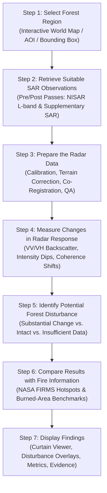
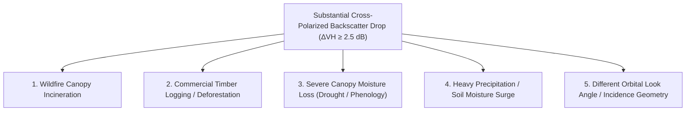

# Domain 2: Forests & Wildfires — Specification & Documentation
**Team Member 2 — Radar-Based Forest Change and Fire Impact Analysis**

Welcome to the comprehensive scientific, architectural, and operational specification for **Domain 2: Forests & Wildfires** of the **NISAR — Dancing with the SARs** platform.

---

## 1. Executive Summary & Objective

- **Domain Identifier:** `domain2`
- **Domain Name:** **Forests & Wildfires**
- **Assigned Role:** **Team Member 2 — Radar-Based Forest Change and Fire Impact Analysis**
- **Objective:** Develop a SAR-based module that detects forest disturbances and investigates potential wildfire impacts by comparing observations across time.
- **Primary Output:** Georeferenced forest-change maps, affected-area estimates, comparisons with fire records, and independent validation results.
- **Main Technical Challenge:** Distinguishing wildfire damage from other causes of radar backscatter change (e.g., logging, soil moisture fluctuations, seasonal canopy phenology, differing acquisition geometries).
- **Primary Dependencies:** Suitable multi-date SAR observations, baseline forest-cover information, and independent fire or burned-area reference data.

---

## 2. What Problem Does This Domain Solve?

Forests represent critical terrestrial carbon sinks and terrestrial biodiversity reservoirs. Forests change constantly over time due to timber harvesting, illegal deforestation, infrastructure development, agricultural encroachment, wildfires, extreme windstorms, drought dieback, and natural vegetation regrowth.

### Limitations of Ground and Optical Observations
Detecting and quantifying these changes across vast, remote biomes (e.g., the Amazon basin, the boreal taiga, Mediterranean woodland belts) is impossible using ground surveys alone. Optical satellite sensors (such as Sentinel-2 and Landsat) are severely hindered:
1. **Cloud Cover:** Tropical rainforests and humid temperate zones often experience continuous cloud cover, haze, and rain for weeks or months during peak dry-season clearing periods.
2. **Smoke Palls:** During catastrophic wildfire emergencies, dense pyrocumulonimbus clouds, particulate smoke, and aerosols completely obscure the ground from optical instruments.
3. **Greenness Ambiguity:** Optical reflectance primarily senses leaf chlorophyll greenness, which can quickly rebound through rapid weed or grass colonisation even after mature structural canopy biomass has been eradicated.

### Why SAR Solves This Problem
Synthetic Aperture Radar (SAR) uses microwave signals rather than sunlight, providing an all-weather, day-and-night observation system:
- **Structural Canopy Sensitivity:** Microwave pulses at L-band ($\approx 24\text{ cm}$, as on **NISAR**) and C-band ($\approx 5.6\text{ cm}$, as on **Sentinel-1**) penetrate into the canopy. The radar signal interacts with the 3D woody matrix of branches, twigs, and tree trunks via **volume scattering** and **double-bounce reflection**.
- **Disturbance Signature:** When a forest canopy is logged, thinned, or burned, the complex structural volume scattering collapses, causing a pronounced drop in cross-polarized backscatter ($\sigma^0_{\text{VH}}$ or $\sigma^0_{\text{HV}}$).
- **Smoke Penetration:** Microwave radar traverses dense wildfire smoke without attenuation, giving incident responders and scientists a direct view of surface structural damage during active fires.

### Two Related but Distinct Investigations
This domain addresses two interconnected scientific questions:
1. **Forest Change:** Detect radar backscatter changes consistent with forest disturbance, canopy loss, or long-term structural regrowth.
2. **Wildfire Impact:** Identify radar backscatter drops following a fire event and investigate whether they are consistent with fire-related structural destruction rather than other disturbances.

> [!IMPORTANT]
> **SAR Wildfire Boundary Limitation:**
> SAR cannot reliably identify every wildfire by itself. Active-fire detection (thermal hotspots) and burned-area mapping (structural surface changes) are fundamentally different tasks, each requiring appropriate physical evidence.

---

## 3. The 7-Step Module Workflow

The module executes a 7-step analytical pipeline:



### Step 1 — Select the Forest Region
The user selects a forested study area using the interactive map (`/earth-event-explorer` or `/domain2`). They can search for named study areas (e.g., `"Novo Progresso, Pará, Brazil"` or `"Dadia Forest, Greece"`), click preset regional case studies, or define custom bounding-box coordinates.

### Step 2 — Retrieve Suitable SAR Observations
The system retrieves geocoded SAR observations from appropriate dates before and after the suspected disturbance:
- **Primary Source:** **NISAR L-band SAR** (L-SAR) provides superior penetration into heavy timber and high sensitivity to woody biomass changes.
- **Supplementary Source:** **Copernicus Sentinel-1 C-band SAR** (C-SAR RTC) provides high-frequency multi-year baseline monitoring.
- The platform explicitly tags and displays which satellite sensor supplied each observation.

### Step 3 — Prepare the Radar Data
The system prepares the input observations according to sensor geometry and quality requirements:
- Radiometric calibration to linear power and decibels ($\text{dB} = 10 \cdot \log_{10}(\text{power})$).
- Pixel-for-pixel co-registration and spatial alignment to the baseline grid using bilinear resampling.
- Spatial speckle reduction via boxcar spatial filtering (e.g., $5\times5$ window) to suppress speckle noise without blurring genuine forest boundaries.

### Step 4 — Measure Changes in Radar Response
The system evaluates multiple physical radar features across the pre- and post-disturbance acquisitions:
- **Cross-Polarized Backscatter ($\sigma^0_{\text{VH}}$ / $\sigma^0_{\text{HV}}$):** Measures loss of canopy volume scattering.
- **Co-Polarized Backscatter ($\sigma^0_{\text{VV}}$ / $\sigma^0_{\text{HH}}$):** Analyzes surface roughness and soil exposure.
- **Cross-Ratio / Polarimetric Features ($\sigma^0_{\text{VH}} / \sigma^0_{\text{VV}}$):** Isolates canopy structure from ground dielectric variations.
- **Interferometric Coherence ($\gamma$):** When repeat-pass interferometric pairs are available, severe structural destruction causes sharp loss of interferometric coherence.
- **Canopy Drift Normalization:** Compares median backscatter across unlogged intact core forest to compensate for scene-wide canopy moisture fluctuations between passes.

### Step 5 — Identify Potential Forest Disturbance
The system classifies the terrain into three explicit confidence categories:
1. **Substantial Change:** Pixels exhibiting cross-polarized backscatter drop exceeding the sensitivity threshold ($\Delta\text{VH} \ge 2.0\text{--}3.0\text{ dB}$) that persist after Minimum Mapping Unit (MMU) cluster sieving ($\ge 6\text{ pixels}$).
2. **Little Detectable Change:** Pixels within normal seasonal variation bounds ($\pm 1.0\text{ dB}$).
3. **Insufficient Data / Masked:** Pixels outside the baseline forest mask (non-forest, water, agriculture) or invalidated by steep layover/shadow.

### Step 6 — Compare Results with Fire Information
To determine whether observed radar changes stem from wildfire impacts rather than logging or drought:
- Ingests **NASA FIRMS** active thermal fire detections (MODIS/VIIRS $375\text{ m}$ and $1\text{ km}$ points).
- Computes spatial intersection between radar disturbance polygons and thermal fire clusters.
- Cross-compares against independent burned-area products (e.g., NASA MODIS **MCD64A1** v061).

### Step 7 — Display the Findings
The user inspects an integrated multi-panel workspace:
- Synchronized Before/After curtain swipe slider comparing pre- and post-disturbance radar images.
- Color-coded disturbance overlay highlighting confirmed structural canopy loss.
- Summary metrics detailing potential disturbance area (hectares and $\text{km}^2$), mean volume scattering loss ($\text{dB}$), and number of corroborated FIRMS thermal detections.
- Confusion matrix validation against independent forest loss or burned-area reference data.
- Transparent 4-tier scientific explainability report and caveats.

---

## 4. Recommended Dataset Combination

$$\text{NISAR} + \text{Sentinel-1} + \text{NASA FIRMS} + \text{MODIS Burned Area} + \text{Landsat / Sentinel-2} + \text{Forest-Cover Reference}$$

| Dataset | Sensor / Platform | Primary Role in Domain 2 | Why It Is Distinct & Essential |
| :--- | :--- | :--- | :--- |
| **NISAR L-SAR & S-SAR** | NASA-ISRO SAR ($24\text{ cm}$ L-band / $9.3\text{ cm}$ S-band) | Primary radar observations for structural canopy scattering and sub-canopy ground changes. | L-band microwave pulses penetrate deep into tree crowns to interact with main woody limbs, providing direct sensitivity to structural biomass removal. |
| **Sentinel-1 C-SAR** | Copernicus Sentinel-1A/1B ($5.6\text{ cm}$ C-band RTC) | High-frequency historical baseline and multi-date change detection. | Dense 6-to-12 day historical archive enables rapid disturbance detection and provides consistent cross-frequency comparison with NISAR. |
| **NASA FIRMS** | Terra/Aqua MODIS & Suomi-NPP/NOAA-20 VIIRS | Satellite-detected active fire thermal anomalies (hotspots). | Establishes the precise timing and geographical location of active combustion, confirming that radar canopy loss coincides with wildfire activity. |
| **MODIS Burned Area (MCD64A1)** | NASA Terra/Aqua MODIS ($500\text{ m}$ Monthly Burned Area) | Independent burned-area reference benchmark. | Supplies an authoritative, independent global burned-area benchmark to validate the spatial accuracy and perimeter of radar-detected burn scars. |
| **Landsat (5–9) & Sentinel-2** | NASA/USGS Landsat & ESA Sentinel-2 MSI | Optical multispectral surface reflectance and vegetation indices (NDVI, NBR, dNBR). | Provides optical spectral confirmation (vegetation vigor and charcoal reflectance) when cloud conditions permit, complementing structural radar changes. |
| **Forest-Cover Reference** | JAXA ALOS-2 PALSAR-2 FNF / Hansen Global Forest Change | Baseline forest-cover mask. | Restricts the disturbance analysis strictly to established tree canopies, eliminating false positives over annual agricultural crops or grasslands. |

> [!WARNING]
> **FIRMS Active-Fire Data Limitation:**
> FIRMS active-fire detections represent instantaneous thermal hotspot observations at the satellite overpass time. FIRMS **does not directly provide a complete perimeter of burned land**. Fires frequently ignite, spread, and extinguish between satellite overpasses, and cloud/smoke shadows can obscure thermal detections. FIRMS must be used as corroborating evidence rather than as a complete burned-area boundary.

---

## 5. Scientific Methods & The Critical Distinction

### Methods Employed

| Method | Purpose | Implementation |
| :--- | :--- | :--- |
| **Backscatter Analysis** | Measure changes in radar scattering response across observations. | Decibel conversion ($\sigma^0\text{ dB}$); evaluate cross-polarized ($\text{VH}/\text{HV}$) volume loss and co-polarized ($\text{VV}/\text{HH}$) surface return. |
| **Multi-Date Change Detection** | Identify areas where radar scattering has significantly decreased over time. | Pixel difference ($\Delta\text{VH} = \sigma^0_{\text{pre}} - \sigma^0_{\text{post}}$) combined with intact canopy drift normalization. |
| **Coherence Analysis** | Use changes in interferometric phase coherence where suitable SLC data exist. | Masks decorrelated pixels; identifies catastrophic structural destruction via temporal coherence loss. |
| **Forest-Cover Masking** | Restrict analysis to areas identified as established tree canopy. | Subtraction of non-forest land cover (JAXA ALOS-2 FNF or Hansen GFC tree canopy $>30\%$). |
| **Fire-Record Comparison** | Examine whether observed changes correspond to verified fire activity. | Spatial intersection and point-in-polygon counting of NASA FIRMS active fire hotspots. |
| **Accuracy Assessment** | Compare detections against independent reference data. | Confusion matrix: True Positives (TP), False Positives (FP), False Negatives (FN), IoU, Precision, Recall, and F1 score. |

### The Critical Scientific Distinction: Cause vs. Effect

When radar backscatter drops substantially between two dates over a forested pixel, **that change does NOT automatically confirm a wildfire**. A marked drop in cross-polarized radar return can be caused by:



1. **Wildfire Damage:** Rapid combustion of leafy canopy and twigs, collapsing volume scattering.
2. **Logging or Deforestation:** Mechanical clear-cutting or selective timber harvesting removing mature tree structure.
3. **Canopy Moisture & Phenology:** Deciduous leaf shedding during prolonged drought or dry seasons reduces dielectric permittivity and scattering efficiency.
4. **Soil Moisture Shifts:** Extreme soil moisture changes can modify ground reflection components.
5. **Acquisition Geometry Differences:** Different satellite look angles or orbit tracks alter canopy volume path lengths.

> [!CAUTION]
> **Scientific Integrity Requirement:**
> The module must explicitly report **"Potential Forest Disturbance"** until independent secondary evidence (such as NASA FIRMS thermal hotspots, high-resolution optical imagery, or official emergency perimeters) corroborates a specific causation. The platform never labels every darkened pixel as "burned forest."

---

## 6. Finished Module Interface & User Experience

The finished Domain 2 workspace (`/domain2`) provides an interactive interface tailored for forestry and fire analysts:

| Component | UI Feature & Function | User Value |
| :--- | :--- | :--- |
| **Forest Region Selector** | Interactive world map with forest presets (e.g. Pará Amazon, Dadia Megafire) and custom bounding box. | Allows immediate exploration of global forest disturbance and wildfire events. |
| **Date & Sensor Selector** | Chronological pre/post pass dropdown with sensor labels (`Sentinel-1A`, `NISAR L-band`). | Clear identification of satellite provenance and observation baseline. |
| **Radar Comparison Viewer** | Synchronized dual-canvas curtain swipe slider between pre-disturbance and post-disturbance SAR. | Direct visual inspection of forest canopy texture and backscatter changes. |
| **Forest Change Map** | High-contrast disturbance overlay (red) showing confirmed structural canopy volume loss. | Pinpoints localized clearings, fire scars, and logging roads. |
| **Fire Information Layer** | Interactive NASA FIRMS thermal hotspot overlay with detection dates and confidence. | Directly cross-references radar structural loss against active fire locations. |
| **Change Statistics Panel** | Summary cards reporting Potential Disturbance (ha and $\text{km}^2$), Mean Volume Loss ($\text{dB}$), and Corroborated Fire Points. | Objective quantification for forestry audits and emergency response. |
| **Validation Panel** | Error Explorer showing TP/FP/FN pixel counts, IoU (%), F1 (%), Precision (%), Recall (%), and 3-method comparison table. | Transparent benchmark accuracy against independent forest loss or burned-area datasets. |
| **Evidence & Caveats Report** | 4-tier explainability panel with downloadable JSON/HTML reports. | Full scientific provenance, assumptions, and physical caveats ready for export. |

---

## 7. Team Member 2 Ownership & Responsibilities

Team Member 2 owns the following deliverables:

1. **Selecting Suitable SAR Observations:** Identify and configure NISAR L-band, Sentinel-1 C-band RTC, and baseline forest masks for forest and fire study areas.
2. **Developing the Disturbance Detection Pipeline:** Maintain and enhance `backend/app/domains/domain2/processor.py` (speckle filtering, intact canopy drift normalization, MMU cluster sieving).
3. **Investigating Radar Feature Suitability:** Evaluate cross-polarized ($\text{VH}/\text{HV}$) backscatter drop, polarimetric ratios, and coherence changes.
4. **Integrating Independent Fire Records:** Implement spatial intersection between radar disturbance polygons and NASA FIRMS active fire points.
5. **Validating Detected Changes:** Ingest independent reference data (JAXA ALOS-2 FNF, MODIS MCD64A1) and compute objective confusion matrices.
6. **Producing Georeferenced Outputs:** Generate standard GeoTIFF deliverables and high-resolution PNG map overlays.
7. **Documenting Methods & Limitations:** Maintain 4-tier explainability, user caveats, and reproducible documentation.

---

## 8. Backend API Contract & Deliverables

### Endpoint: `POST /api/domains/domain2/process`

```json
{
  "inputs": {
    "baseline": "ds-real-d2-base",
    "event": "ds-real-d2-event",
    "forest_mask": "ds-real-d2-mask",
    "reference_disturbance": "ds-real-d2-ref",
    "fire_detections": "ds-real-d5-firms",
    "exposure_assets": "ds-real-d2-exp"
  },
  "parameters": {
    "min_drop_db": 2.0,
    "filter_window": 5,
    "min_cluster_pixels": 6,
    "normalize_canopy_drift": true
  }
}
```

### Deliverable Files in `data/outputs/domain2/{run_id}/`:
- `forest_disturbance.tif`: Binary disturbance GeoTIFF (`1` = potential canopy disturbance).
- `baseline_preview.png`: Calibrated pre-disturbance cross-polarized SAR preview.
- `event_preview.png`: Calibrated post-disturbance cross-polarized SAR preview.
- `canopy_change_map.png`: Diverging backscatter change map ($\Delta\text{VH}$ in $\text{dB}$).
- `disturbance_overlay.png`: Transparent red overlay layer for map visualization.
- `run_metadata.json`: Full 15-section scientific provenance, metrics, and validation record.

---

## 9. Verified Real-Data Case Studies

The platform provides two verified real-satellite case studies:

### Case Study A: Pará Amazon Forest Disturbance (Brazil)
- **Location:** Novo Progresso / BR-163 Deforestation Corridor, Pará, Brazil.
- **Satellite Data:** Copernicus Sentinel-1A IW GRDH RTC VH (`2019-08-26` vs. `2020-08-20`).
- **Forest Mask:** JAXA ALOS-2 PALSAR-2 L-band Global Forest/Non-Forest (FNF) 2019 baseline ($25\text{ m}$).
- **Validation Reference:** Independent JAXA ALOS-2 FNF 2019→2020 Forest Loss benchmark.
- **Scientific Caveat:** Documents temporal baseline mismatch where early dry-season clearings preceded the August 2019 pass, and accounts for a $+0.81\text{ dB}$ intact canopy moisture drift.

### Case Study B: Dadia Forest / Evros Megafire (Greece)
- **Location:** Dadia-Lefkimi-Soufli National Park, Evros, Greece (August 2023).
- **Satellite Data:** Copernicus Sentinel-1A IW GRDH RTC VH (`2023-08-09` vs. `2023-09-02`).
- **Fire Corroboration:** 1,422 NASA Terra/Aqua MODIS active fire thermal anomaly points (`MOD14A1`/`MYD14A1`).
- **Validation Reference:** NASA MODIS **MCD64A1** v061 Burned-Area monthly product (`DOY 232–242`).
- **Validation Score:** $\text{IoU} = 31.9\%$, $\text{F1} = 48.3\%$, $\text{Precision} = 99.99\%$, $\text{Recall} = 31.9\%$, evaluating the coarse-to-fine scale transition ($500\text{ m}$ MODIS to $29.5\text{ m}$ SAR).

---

## 10. References

- [NASA NISAR Mission Science & Applications](https://science.nasa.gov/mission/nisar/)
- [NASA FIRMS Fire Information for Resource Management System](https://firms.modaps.eosdis.nasa.gov/)
- [Alaska Satellite Facility (ASF) DAAC Data User Guides](https://asf.alaska.edu/information/data-user-guides/)
- [JAXA ALOS-2 PALSAR-2 Global Forest/Non-Forest Map](https://www.eorc.jaxa.jp/ALOS/en/dataset/fnf_e.htm)
- [NASA MODIS MCD64A1 Burned Area Product Documentation](https://modis.gsfc.nasa.gov/data/dataprod/mod64.php)
- Hansen, M. C., et al. (2013). *High-resolution global maps of 21st-century forest cover change.* Science, 342(6160), 850–853.
