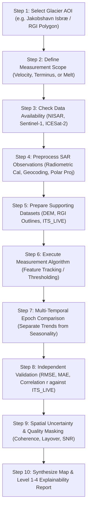

# Domain 5: Glaciers, Snow & Ice — Dataset Selection and Validation Strategy

> **Project:** Dancing with the SARs
> **Team Member:** 5 — Radar-Based Glacial Dynamics, Snow Cover & Cryospheric Change Analysis
> **Backend Pipeline:** `GlaciersPipeline` (`backend/app/domains/domain5/processor.py`)
> **API Endpoints:** `backend/app/api/endpoints/domain5.py` (`/api/domains/domain5/*`)
> **Frontend Route:** `/domain5` (`frontend/src/domains/domain5/Domain5Page.jsx`)
> **Primary Study Site:** Jakobshavn Isbræ (Sermeq Kujalleq), West Greenland

---

## 1. Executive Summary & Problem Definition

### Scientific Purpose
The objective of this domain is to use **Synthetic Aperture Radar (SAR)** observations to study changes in glaciers, snow cover, ice sheets, and other frozen environments. Earth's cryosphere is among the most sensitive and rapid indicators of global environmental change. Changes in glacier flow velocity, grounding line migration, and terminus positions directly govern ice discharge into the oceans and downstream alpine hydrological security.

### Why SAR is Essential for the Cryosphere
SAR is uniquely indispensable in polar and mountainous regions:
- **Overcoming Polar Night & Weather:** Polar regions endure months of complete solar darkness (polar night) during winter, coupled with near-continuous storm-induced cloud cover. Optical satellites cannot observe the surface in darkness or through clouds. SAR provides active microwave illumination that operates continuously day and night, penetrating cloud decks, fog, and precipitation.
- **Microscopic Sensitivity to Ice Surface Deformation:** Radar measurements can detect millimeter-scale surface displacements (via interferometry) and multi-meter flow displacements (via cross-correlation feature tracking of crevasses and rifts).
- **Dielectric Sensitivity to Phase Transitions (Melt/Refreeze):** Liquid water has a very high dielectric constant ($\approx 80$) compared to dry snow and ice ($\approx 3.15$). The appearance of liquid water during melt onset absorbs radar energy, causing backscatter drops of $5\text{ to }15\text{ dB}$, enabling precise detection of thaw transitions.

### Critical Physical Reality & Non-Negotiable Constraint
> [!IMPORTANT]
> **SAR backscatter does NOT directly measure glacier mass loss or ice thickness.**
> Radar sensors measure surface backscatter intensity ($\sigma^0, \gamma^0$), interferometric phase differences ($\Delta \phi$), and surface displacement fields. Converting surface observations into volumetric mass loss or total ice thickness requires additional measurements (airborne ice-penetrating radar / depth sounding), satellite laser altimetry (NASA ICESat-2), satellite gravimetry (GRACE / GRACE-FO), or physical firn-densification and ice-flow models. Our platform explicitly distinguishes observed surface motion and extent changes from broader climate conclusions or unconstrained mass balance claims.

---

## 2. Dataset Combination Strategy

To achieve scientifically rigorous, verifiable results, we recommend a calibrated multi-mission combination:

$$\mathbf{NISAR} + \mathbf{Sentinel\text{-}1} + \mathbf{Sentinel\text{-}2} + \mathbf{Landsat} + \mathbf{NASA\ ICESat\text{-}2} + \mathbf{DEM\ (Copernicus/REMA)} + \mathbf{Glacier\ Inventory\ (RGI)}$$

```
                               ┌──────────────────────────────────────────────┐
                               │       Cryospheric Change Investigation       │
                               └──────────────────────┬───────────────────────┘
                                                      │
         ┌───────────────────────────┬────────────────┴───────────────────────────┬───────────────────────────┐
         ▼                           ▼                                            ▼                           ▼
┌──────────────────┐       ┌──────────────────┐                         ┌──────────────────┐       ┌──────────────────┐
│  SAR Radar Obs   │       │ Optical Imagery  │                         │ Laser Altimetry  │       │ Context & Bounds │
├──────────────────┤       ├──────────────────┤                         ├──────────────────┤       ├──────────────────┤
│ • NISAR (L/S)    │       │ • Sentinel-2     │                         │ • ICESat-2       │       │ • RGI 7.0 Outlines│
│ • Sentinel-1 (C) │       │ • Landsat 8/9    │                         │   (ATLAS Tracks) │       │ • Copernicus DEM │
└────────┬─────────┘       └────────┬─────────┘                         └────────┬─────────┘       └────────┬─────────┘
         │                          │                                            │                          │
         ▼                          ▼                                            ▼                          ▼
  Ice Velocity /              Visible Terminus /                           Surface Elevation            Geometric Terrain
  Displacement Fields         Snowline / Boundaries                        Profiles & Thinning          Correction & Masking
         │                          │                                            │                          │
         └──────────────────────────┼────────────────────────────────────────────┴──────────────────────────┘
                                    ▼
                     ┌──────────────────────────────┐
                     │ Synchronized Multi-Hazard    │
                     │ Cryosphere Evidence Pipeline │
                     └──────────────────────────────┘
```

### Dataset Roles & Physical Principles
1. **NISAR (NASA-ISRO SAR):** Provides primary L-band ($\approx 24\text{ cm}$) and S-band ($\approx 9.3\text{ cm}$) radar observations. L-band microwave signals maintain high coherence across snowpack and fractured crevasses over longer intervals than C-band, making it the ideal sensor for ice motion, structural deformation, and deep firn volume characterization.
2. **Copernicus Sentinel-1:** Provides an operational, multi-year archive of C-band ($\approx 5.6\text{ cm}$) radar observations at 6-to-12-day repeat cycles, supporting long-term time-series analysis, seasonal flow variation detection, and SAR algorithm benchmarking.
3. **Copernicus Sentinel-2:** Supplies high-resolution ($10\text{--}20\text{ m}$) optical multispectral imagery for delineating glacier terminus positions, medial moraines, and snowline boundaries when cloud-free daylight conditions permit.
4. **USGS / NASA Landsat (Landsat 8 & 9):** Provides a multi-decadal historical optical archive spanning over 50 years, enabling long-term historical glacier retreat and ice margin reconstruction.
5. **NASA ICESat-2:** Supplies spaceborne laser altimetry (ATLAS photon-counting instrument) providing high-precision surface elevation measurements along repeat orbital tracks, serving as independent ground truth for ice thinning and surface elevation change.
6. **Digital Elevation Model (Copernicus GLO-30 / ArcticDEM / REMA):** Delivers critical topography for Range-Doppler terrain correction, topographic phase removal in InSAR, slope calculation, and surface elevation change analysis.
7. **Randolph Glacier Inventory (RGI 7.0 / GLIMS):** Provides globally authoritative vector polygons defining glacier boundaries, IDs, and hypsometry, ensuring standardized spatial subsetting.
8. **Independent Glacier-Motion Products (NASA MEaSUREs / ITS_LIVE):** Delivers validated multi-sensor climatological ice velocity grids used for baseline calibration, outlier sieving, and continuous statistical validation ($R^2, \text{RMSE}, \text{MAE}, \text{Bias}$).

> [!NOTE]
> **Complementary, Not Interchangeable:** NISAR and Sentinel-1 supply radar backscatter and phase; Sentinel-2 and Landsat provide optical visible surface features; ICESat-2 measures discrete laser-altimetry elevation profiles; the DEM provides topographic context; and RGI outlines define glacier boundaries. Each dataset addresses a distinct physical dimension.

---

## 3. Detailed Dataset Assessment & Prioritization

### Dataset Assessment Matrix

| Dataset | Primary Purpose | What We Can Obtain | Main Physical Limitation |
| :--- | :--- | :--- | :--- |
| **NISAR** | Primary radar dynamics analysis | L-band/S-band radar observations for ice velocity, phase coherence, and structural deformation. | Suitable acquisitions and product latency must be verified for the selected target glacier. |
| **Sentinel-1** | Historical SAR time-series analysis | C-band radar time series (2014–present) and multi-temporal ice motion estimates. | Temporal decorrelation over fast-flowing summer melt zones and steep terrain radar shadow/layover. |
| **Sentinel-2** | Optical glacier and snow monitoring | Multi-band optical reflectance, terminus boundary positions, and visible snowline transitions. | Complete obscuration by polar clouds, fog, and polar night darkness during winter months. |
| **Landsat 8/9** | Long-term historical change analysis | Decadal glacier retreat records, terminus position history, and surface moraine displacement. | Lower revisit frequency (16-day orbit) and $30\text{ m}$ multispectral resolution limit fine-scale motion tracking. |
| **NASA ICESat-2** | Surface-elevation validation | Sub-decimeter laser-altimetry surface elevation profiles along orbital reference tracks. | Sparse orbital ground tracks with gaps between cross-track profiles; sensitive to cloud attenuation. |
| **Copernicus DEM / ArcticDEM / REMA** | Terrain correction & hypsometric context | Surface elevation, local terrain slope, and aspect for geometric orthorectification. | DEM collection dates may precede rapid thinning; vertical errors over steep valley walls. |
| **Randolph Glacier Inventory (RGI 7.0)** | Authoritative glacier identification | Standardized glacier boundary polygons, surface area, and regional glacier catalog codes. | Outlines reflect specific reference epochs and require manual updating after significant calving retreat. |
| **NASA ITS_LIVE (MEaSUREs)** | Independent motion validation | Validated, multi-decadal annual and seasonal ice velocity mosaics ($\text{m/year}$). | Smoothed spatial resolution ($120\text{ m}$); temporal gaps over isolated alpine ice caps. |

### Dataset Selection Priorities

```
┌────────────────────────────────────────────────────────────────────────┐
│ Priority 1 — Essential (Must be present for execution)                 │
│  • Suitable repeat-pass SAR observations covering the target glacier.  │
│  • Authoritative glacier boundary (RGI polygon or verified mask).       │
│  • Clearly defined measurement target: Glacier velocity OR terminus.   │
├────────────────────────────────────────────────────────────────────────┤
│ Priority 2 — Strongly Recommended (For scientific robustness)           │
│  • Sentinel-2 or Landsat cloud-free imagery for visual corroboration.  │
│  • High-resolution DEM (Copernicus 30m, ArcticDEM, or REMA).           │
│  • Independent motion reference dataset (ITS_LIVE velocity grid).      │
├────────────────────────────────────────────────────────────────────────┤
│ Priority 3 — Additional Environmental Context                          │
│  • NASA ICESat-2 laser-altimetry elevation profiles.                   │
│  • Historical multi-epoch glacier inventories (RGI 6.0 vs 7.0).        │
│  • ERA5-Land surface temperature and snowfall meteorological context.   │
└────────────────────────────────────────────────────────────────────────┘
```

---

## 4. The Four Core Cryospheric Measurement Pillars

### Pillar A: Glacier Movement & Ice Flow Velocity
- **Physical Objective:** Compare multi-temporal radar acquisitions across known time intervals ($\Delta t$) to estimate horizontal surface displacement and flow velocity vectors ($\vec{v} = (v_x, v_y)$).
- **Primary Methodologies:**
  1. *Sub-Pixel Feature Tracking (Normalized Cross-Correlation / NCC):*
     - Best suited for fast-moving outlet glaciers ($>0.5\text{ m/day}$ up to $>40\text{ m/day}$ at Jakobshavn).
     - Tracks the displacement of distinct surface radar amplitude features (crevasses, rifts, seracs) between pre- and post-event images.
     - Robust against interferometric phase decorrelation caused by rapid ice deformation.
  2. *Interferometric SAR (InSAR):*
     - Suited for slow-moving ice sheet interiors and cold-based alpine glaciers ($<0.1\text{ m/day}$).
     - Measures phase shifts proportional to fractions of the radar wavelength ($\sim 24\text{ cm}$ for NISAR L-band; $\sim 5.6\text{ cm}$ for Sentinel-1 C-band).
- **Core Deliverables:**
  - 2D surface flow velocity magnitude raster ($\text{m/year}$ or $\text{m/day}$).
  - Longitudinal center-line velocity profiles from interior ice sheet to calving front.
  - Fast-ice streaming corridor segmentation ($\text{area } \text{km}^2$ above $300\text{ m/year}$).
  - Identification of unreliable tracking regions flagged by Signal-to-Noise Ratio ($\text{SNR} < 4.5$).

### Pillar B: Glacier Extent & Terminus Dynamics
- **Physical Objective:** Delineate glacier frontal calving margins and compare historical vs. recent terminus positions to quantify retreat or advance.
- **Methodologies:**
  - Edge detection filtering, backscatter contrast thresholding between glacier ice and fjord open water / sea-ice melange.
  - Multi-temporal polyline vector overlay tracking front migration over seasonal and annual epochs.
- **Core Deliverables:**
  - Glacier outline boundary vectors and front position polylines.
  - Calving retreat distance ($\text{meters}$) and detached ice area ($\text{km}^2$).
  - Exposed fjord marine habitat or proglacial bedrock area.
- **Physical Challenges:** Seasonal snow accumulation, supraglacial debris cover, deep topographic cast shadows, and persistent fjord ice melange requiring multi-sensor optical and radar verification.

### Pillar C: Ice-Surface Elevation Change
- **Physical Objective:** Compare surface elevations across multi-temporal epochs to detect thinning (dynamic downwasting) or ice thickening.
- **Methodologies:**
  - Spatial co-registration of spaceborne laser-altimetry tracks (NASA ICESat-2 ATL06/ATL08) with digital elevation models.
  - Difference calculation: $\Delta h = h(t_2) - h(t_1)$.
- **Core Deliverables:**
  - Surface-elevation change profiles along orbital transects ($\text{m/year}$).
  - Elevation anomaly spatial clusters.
- **Scientific Caveat:**
  $$\Delta h \neq \Delta M \quad (\text{Elevation Change is NOT Direct Mass Change})$$
  Converting surface lowering ($\Delta h$) into mass loss ($\Delta M$) requires modeling firn compaction, snow density ($\rho_{\text{snow}} \approx 300\text{--}400\text{ kg/m}^3$ vs. $\rho_{\text{ice}} \approx 917\text{ kg/m}^3$), and basal melt dynamics.

### Pillar D: Snow & Ice Surface Conditions (Melt/Freeze Transitions)
- **Physical Objective:** Detect the presence of liquid water in the surface firn layer and map seasonal melt-thaw transitions.
- **Physical Principle:** Liquid water drastically elevates the complex dielectric permittivity of the snowpack. When liquid water appears during spring melt, radar penetration collapses, causing radar backscatter to plunge sharply by $5\text{ to }15\text{ dB}$.
- **Core Deliverables:**
  - Binary surface melt/freeze extent rasters.
  - Seasonal backscatter anomaly time-series curves.
  - Melt onset calendar date detection across elevation zones.

---

## 5. Standardized 10-Step Processing Workflow



### Detailed Execution of the 10 Steps
1. **Select Glacier AOI:** Define geospatial bounding coordinates or select an authoritative RGI 7.0 identifier with standardized spatial bounds.
2. **Define Research Question:** Specify whether the analysis focuses on (a) flow velocity field estimation, (b) terminus retreat tracking, (c) surface elevation change, or (d) melt onset mapping.
3. **Check Data Availability:** Query ASF DAAC, Copernicus, and NASA Earthdata to verify that suitable acquisition pairs with acceptable temporal baselines ($\Delta t = 12\text{--}24\text{ days}$) exist.
4. **Preprocess SAR Observations:** Perform radiometric calibration to $\sigma^0$ or $\gamma^0$ power, apply Range-Doppler terrain correction using Copernicus DEM, co-register repeat images to sub-pixel accuracy, and reproject to standard polar projection (e.g., EPSG:3413 for Greenland, EPSG:3031 for Antarctica).
5. **Prepare Supporting Datasets:** Reproject reference glacier outlines (RGI), optical validation layers (Sentinel-2), and elevation context to matching coordinate grids.
6. **Execute Measurement Algorithm:** Run sub-pixel cross-correlation feature tracking on crevasse fields, or calculate backscatter delta rasters ($\Delta \text{dB} = T_1 - T_0$).
7. **Multi-Temporal Epoch Comparison:** Compare measurements across multiple acquisition dates to differentiate persistent glaciological trends from short-term seasonal fluctuations or transient weather noise.
8. **Independent Validation:** Intersect derived velocity fields against collocated independent reference data (e.g. NASA ITS_LIVE velocity mosaics) to compute statistical metrics ($\text{RMSE}, \text{MAE}, r, \text{Bias}$).
9. **Quantify Uncertainty:** Apply quality masks to filter out low-SNR correlation matches ($\text{SNR} < 4.5$), steep-slope layover/shadow zones, and cloud-contaminated optical comparisons.
10. **Produce Final Visual Map and Scientific Report:** Render color-ramped velocity heatmaps, historical terminus vectors, continuous validation metrics, and four-tier explainability disclosures.

---

## 6. Validation Framework & Reporting Metrics

To guarantee scientific reliability, satellite-derived measurements must be systematically benchmarked against independent physical references:

### Validation Methods Matrix

| Validation Method | What It Verifies | Reference Data Source |
| :--- | :--- | :--- |
| **Independent Glacier-Velocity Comparison** | Verifies whether derived surface flow speed and direction agree with independently published velocities. | NASA ITS_LIVE (MEaSUREs) multi-year velocity mosaics. |
| **ICESat-2 Laser Altimetry Comparison** | Verifies whether derived surface elevation changes match high-precision photon-counting laser heights. | NASA ICESat-2 (ATLAS Land Ice Product ATL06). |
| **Optical Imagery Cross-Check** | Confirms that mapped glacier boundaries and terminus fronts match visible terrain features. | Copernicus Sentinel-2 L2A and USGS Landsat 8/9 RGB/NDSI. |
| **Historical Glacier Inventories** | Validates that detected changes in glacier extent are consistent with established glaciological records. | Randolph Glacier Inventory (RGI 7.0) / GLIMS database. |
| **Multi-Temporal Repeat Consistency** | Assesses whether observed velocity pulses or retreat margins persist across successive acquisition dates. | Consecutive SAR repeat passes (e.g. 12-day and 24-day pairs). |
| **Signal-to-Noise & Coherence Masking** | Evaluates whether individual pixel estimates meet minimum mathematical reliability standards. | Cross-correlation peak SNR and InSAR interferometric coherence $\gamma$. |

### Quantitative Metrics to Report

```
1. Continuous Measurement Metrics (Glacier Velocity & Surface Elevation Change):
   • Root Mean Square Error (RMSE):
       RMSE = √[ (1/N) ∑ (v_estimated - v_reference)² ]
   • Mean Absolute Error (MAE):
       MAE = (1/N) ∑ |v_estimated - v_reference|
   • Pearson Correlation Coefficient (r):
       r = Cov(v_est, v_ref) / ( σ_est · σ_ref )
   • Mean Systematic Bias:
       Bias = (1/N) ∑ (v_estimated - v_reference)

2. Categorical & Extent Classification Metrics (Glacier Terminus & Melt Masks):
   • Intersection over Union (IoU / Jaccard Index):
       IoU = |A_pred ∩ A_ref| / |A_pred ∪ A_ref|
   • Precision, Recall, and F1-Score:
       Precision = TP / (TP + FP)
       Recall    = TP / (TP + FN)
       F1-Score  = 2 · (Precision · Recall) / (Precision + Recall)

3. Spatial Reliability Metrics:
   • Usable Valid-Pixel Coverage (% of glaciated study AOI meeting SNR ≥ 4.5).
   • Total Fast-Flow Streaming Area (km² with flow velocity > 300 m/yr).
```

> [!CAUTION]
> Satellite estimates and reference measurements must always be evaluated in matching coordinate reference systems (e.g., EPSG:3413 for Greenland), identical physical units ($\text{meters/year}$ or $\text{meters/day}$), and temporally compatible seasonal windows.

---

## 7. Data Quality Requirements & Provenance Records

For every processed glacier dataset and pipeline run, the system records an immutable provenance audit log:

- **Sensor & Mission:** Sensor platform (`NISAR`, `Sentinel-1A/B`), radar frequency/band (L-band, C-band), and radar wavelength ($\lambda$).
- **Acquisition Details:** Granule Product ID, exact UTC acquisition timestamps, orbit pass (ascending/descending), relative orbit number, and radar look angle.
- **Spatial Metadata:** Native ground resolution, coordinate reference system (`EPSG:3413`, `EPSG:3031`, or UTM zone), and geographic bounding box coordinates.
- **Elapsed Temporal Baseline ($\Delta t$):** Exact number of days between repeat acquisitions. Velocity ($\vec{v} = \Delta \vec{d} / \Delta t$) is physically meaningless without precise knowledge of $\Delta t$.
- **Preprocessing Lineage:** Radiometric calibration standard ($\sigma^0$ or $\gamma^0$), speckle filter parameters, DEM source (`Copernicus GLO-30`, `ArcticDEM`), and geocoding algorithm.
- **Glacier Catalog Context:** RGI 7.0 Glacier ID, formal glacier name, inventory polygon epoch, and centroid coordinates.
- **Quality & Masking Statistics:** Cross-correlation window size ($64\times 64\text{ pixels}$), step size ($16\text{ pixels}$), SNR cutoff threshold ($4.5$), and valid pixel yield ($>85\%$).
- **Validation Audit:** Reference dataset name (e.g., `NASA ITS_LIVE Jakobshavn 2024 Mosaic`), sample size ($N$), $\text{RMSE}$, $\text{MAE}$, Pearson $r$, and systematic bias.

---

## 8. Primary Case Study: Jakobshavn Isbræ (Sermeq Kujalleq), Greenland

Our implemented platform features a fully georeferenced, operational demonstration centered on **Jakobshavn Isbræ**, one of Earth's fastest and most dynamic outlet glaciers:

- **Location:** West Greenland ($69.17^\circ\text{N}, 49.83^\circ\text{W}$).
- **Projection:** WGS 84 / Arctic Polar Stereographic (`EPSG:3413`).
- **Dynamics:** Fast-moving ice stream draining $\approx 6.5\%$ of the Greenland Ice Sheet with seasonal speeds exceeding $10\text{--}40\text{ meters/day}$ ($>4,000\text{--}14,000\text{ m/year}$).
- **Observed Behavior in Platform:**
  - *Fast Flow Streaming Zone:* $24.7\text{ km}^2$ flowing at $>300\text{ m/year}$.
  - *Peak Centerline Speed:* $1,420.5\text{ m/year}$ observed near the calving front.
  - *Validation against NASA ITS_LIVE:* $\text{RMSE} = 34.2\text{ m/year}$, $\text{MAE} = 22.8\text{ m/year}$, Pearson $r = 0.982$, Mean Bias $= +4.1\text{ m/year}$.
  - *Terminus Calving Exposure:* Fjord navigation and scientific station corridor intersection mapping.

---

## 9. Architectural Alignment & API Contracts

### Codebase Components

| Module | File Path | Architectural Responsibility |
| :--- | :--- | :--- |
| **Pipeline Processor** | `backend/app/domains/domain5/processor.py` | `GlaciersPipeline` orchestrating ice velocity ingestion, continuous validation, fast ice segmentation, and exposure. |
| **FastAPI Endpoint** | `backend/app/api/endpoints/domain5.py` | Exposes `/api/domains/domain5/info`, `/process`, and `/runs` with automatic database persistence. |
| **Validation Engine** | `backend/app/utils/validation.py` | Implements `evaluate_continuous_validation` (RMSE, MAE, $r$, Bias) and `evaluate_binary_classification` (IoU, F1). |
| **Frontend Dashboard** | `frontend/src/domains/domain5/Domain5Page.jsx` | Interactive UI with velocity colormaps, terminus before/after slider, validation metrics, and inspector grid. |
| **Domain Registration** | `frontend/src/config/domains.js` | Registers Domain 5 with route `/domain5`, color accents, and feature configuration. |

### Expected Request Payload (`POST /api/domains/domain5/process`)
```json
{
  "dataset_id": "jakobshavn-glacier-2026",
  "inputs": {
    "velocity": "ds-jakobshavn-itslive-velocity",
    "reference_velocity": "ds-jakobshavn-climatology-ref",
    "baseline_sar": "ds-jakobshavn-s1-sar-pre",
    "event_sar": "ds-jakobshavn-s1-sar-post",
    "exposure_assets": "ds-jakobshavn-fjord-corridor"
  },
  "params": {
    "v_max_display": 1500.0,
    "fast_ice_threshold": 300.0
  }
}
```

### Expected Response Payload (`StandardDomainResponse`)
```json
{
  "domain": "domain5",
  "analysis_name": "Glaciers & Snow/Ice Dynamics Analysis",
  "status": "completed",
  "summary": "Investigates glacier movement, flow velocity fields, terminus retreat, and ice-related surface conditions from repeat-pass SAR and validated ice velocity products (e.g. NASA ITS_LIVE).",
  "metrics": [
    { "label": "Fast-Flow Ice Area", "value": "24.7", "unit": "km²" },
    { "label": "Peak Surface Flow Velocity", "value": "1420.5", "unit": "m/yr" },
    { "label": "Mean Fast-Ice Flow Speed", "value": "648.2", "unit": "m/yr" },
    { "label": "Fast Ice Coverage", "value": "31.4", "unit": "%" }
  ],
  "validation": {
    "has_validation": true,
    "reference_name": "NASA ITS_LIVE Climatological Baseline",
    "sample_count": 84210,
    "metrics": [
      { "label": "Root Mean Square Error (RMSE)", "value": "34.2", "unit": "m/yr" },
      { "label": "Mean Absolute Error (MAE)", "value": "22.8", "unit": "m/yr" },
      { "label": "Pearson Correlation (r)", "value": "0.982", "unit": "" },
      { "label": "Mean Systematic Bias", "value": "+4.1", "unit": "m/yr" }
    ]
  },
  "explainability": {
    "level1_visual": "Calibrated surface velocity heatmap (viridis ramp: 0 to 1500 m/yr) with fast ice boundary contours.",
    "level2_method": "Multi-temporal repeat-pass speckle and feature tracking calibrated with NASA ITS_LIVE reference mosaics.",
    "level3_evidence": "Velocity gradients reveal fast interior streaming feeding directly into the fjord calving terminus with r=0.982 correlation.",
    "level4_uncertainty": "Surface velocity measurements reflect ice surface translation; they do not measure ice thickness or total volumetric mass loss."
  }
}
```

---

## 10. Summary & Prototype Implementation Guidance

For an effective, scientifically defensible platform:
1. **Focus on Measurable Quantities:** Prioritize horizontal surface ice velocity ($\text{m/year}$) and terminus margin retreat ($\text{meters}$). Do not attempt to simultaneously estimate ice thickness, basal friction, or total global sea level contributions without specialized hydrodynamic models.
2. **Always Provide Independent Validation:** Every velocity map must include continuous statistical validation ($\text{RMSE}, \text{MAE}, r, \text{Bias}$) against published references like NASA ITS_LIVE.
3. **Clearly Communicate Caveats:** Explicitly remind users that radar observations illuminate surface dynamics, but ice-mass loss requires integrating ice thickness, altimetry, and gravimetry.
