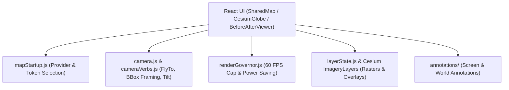

# NISAR Map Engine Interface Specification

**Project:** NASA Space Apps — Dancing with the SARs (NISAR)
**Document:** `docs/integration/map-engine-contract.md`
**Location:** `frontend/src/map-engine/`
**Status:** Approved Standard

---

## 1. Map Engine Architecture

The NISAR map engine encapsulates CesiumJS and Leaflet geospatial rendering primitives, decoupling raw WebGL lifecycle handling from React component logic:

---

## 2. Core Functional Interfaces

### A. Initialization & Provider Fallback (`mapStartup.js`)
- **`selectMapStartupRoute({ googleApiKey, cesiumToken })`**:
  - Prioritizes Google Photorealistic 3D Tiles if API key is provided.
  - Falls back to Cesium Ion token if configured.
  - Automatically defaults to keyless OpenStreetMap / Esri satellite imagery if no credentials exist.
- **`loadPhotorealisticTileset(Cesium, credentials)`**:
  - Attempts tileset mount and captures connection errors gracefully without crashing the UI.

### B. Camera Control & Framing (`camera.js` & `CesiumGlobe.jsx`)
- **`flyToBbox(viewer, bbox_wgs84, options)`**:
  - Converts `[west, south, east, north]` into `Cesium.Rectangle.fromDegrees(west, south, east, north)`.
  - Computes optimal standoff distance (altitude) and heading/pitch for oblique 3D viewing.
  - Smooth animation duration (typically $1.5\text{s}$ cubic easing).
- **`flyToCenter(viewer, [lon, lat], heightMeters)`**:
  - Smoothly translates camera to target coordinates while maintaining orientation.

### C. Raster Imagery Layer Management (`CesiumGlobe.jsx`)
- **`addRasterOverlay(viewer, url, bounds_wgs84, opacity)`**:
  - Constructs `Cesium.SingleTileImageryProvider({ url, rectangle })`.
  - Mounts layer to `viewer.imageryLayers.addImageryProvider()`.
  - Sets alpha transparency (`layer.alpha = opacity`).
- **`removeRasterOverlays(viewer)`**:
  - Safely unmounts and disposes all active analysis overlays when switching runs or domains.

### D. Render Governor & Performance (`renderGovernor.js`)
- Throttles scene rendering when the camera is stationary to prevent GPU resource exhaustion.
- Enforces an upper ceiling of 60 frames per second.
- Manages memory cleanup when components unmount via `viewer.destroy()`.
